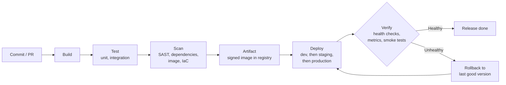

# CI/CD: Fundamentals and Tooling

> The end-to-end delivery flow, CI vs continuous delivery vs deployment, tools by stage, webhooks, and comparing CI/CD platforms.

## Key Concepts

### Overview

An end-to-end delivery pipeline turns a reviewed commit into a verified, running service. Here's how the pieces fit together.

### The Flow

1. A developer writes code and gets it reviewed in GitHub, GitLab, or Azure Repos.
2. A CI system, such as **GitHub Actions** or **Jenkins**, triggers on a pull request or a protected merge.
3. Unit and integration tests, static analysis (**SonarQube**), and dependency, IaC, secret, and container scans (**Trivy**) run to give fast feedback.
4. The build produces one package or Docker image that never changes once it's built. It generates an SBOM and provenance data — a record of where the artifact came from and how it was built — signs the image, and pushes it to a registry like **ECR**.
5. **Terraform** provisions the infrastructure. **Ansible** configures machines, where that model is used.
6. **Helm** or **Kustomize** manifests describe the Kubernetes resources. A GitOps repository records the desired image digest, and **Argo CD** or **Flux** reconciles it — meaning it keeps adjusting the cluster until it matches what's in Git — across clusters like EKS or AKS.
7. A Service, Ingress, or load balancer only routes users to workloads that are actually ready.
8. **Prometheus**, **Grafana**, logs, traces, an APM tool like **Dynatrace**, **Alertmanager**, **Slack**, and **PagerDuty** support verification and day-to-day operations.

### End-to-End CI/CD Flow Diagram

The same flow as a picture. Every step must pass before the next one starts, and the artifact built once is the one that gets deployed everywhere. If verification fails after a deploy, the pipeline rolls back to the last good version.



### Key Principles

- **Build once, promote everywhere.** The same digest moves through every environment — nothing gets rebuilt along the way.
- **Keep configuration external.** Environment differences and secrets live outside the artifact, in version control or a secret manager.
- **Protect production.** Use protected identities and approvals, progressive delivery, health and SLO gates, and a rollback path that's independent of the deploy path.
- **CI proves quality, CD controls promotion.** CI's job is to prove the artifact is good. CD's job is to move it forward safely and confirm the real application works.

### Tools by Stage

| Stage | Typical tools |
| --- | --- |
| Source control | GitHub, GitLab, Azure Repos |
| CI orchestration | GitHub Actions, Jenkins |
| Code quality | SonarQube |
| Security scanning | Trivy, plus dependency/IaC/secret scanners |
| Infrastructure | Terraform, Ansible |
| Kubernetes packaging | Helm, Kustomize |
| GitOps delivery | Argo CD, Flux |
| Target clusters | EKS, AKS |
| Observability | Prometheus, Grafana, Dynatrace |
| Alerting & notifications | Alertmanager, Slack, PagerDuty |

### CI vs. Continuous Delivery vs. Continuous Deployment

**DevOps** is the broader culture and practice: collaboration, automation, measurement, and continuous improvement. CI/CD sits inside that.

| Term | What it means |
| --- | --- |
| Continuous Integration (CI) | Integrate and test changes frequently, so problems surface early |
| Continuous Delivery | Always keep an approved artifact ready to deploy, with a human deciding when to release it |
| Continuous Deployment | Automatically release every change that passes, within defined risk controls |

### Webhooks in CI/CD

A webhook is an HTTP callback sent when something happens. Instead of a CI system repeatedly polling a repository for changes, GitHub, GitLab, or Azure Repos sends a signed event — a push, a pull request, a tag, or a release — straight to the CI/CD endpoint. That endpoint validates the event and decides whether to start a pipeline.

Example flow:

```text
developer push → repository webhook → Jenkins/GitLab/Azure pipeline
→ build and tests → artifact publication → deployment or GitOps update
→ status reported back to the commit and notification channel
```

Security and reliability controls:

- Use TLS, and validate the webhook signature with a secret that gets rotated regularly.
- Only accept expected event types, and validate the repository, branch, and sender.
- Protect against replay using delivery IDs and timestamps. Make event handling idempotent, meaning it's safe to process the same event more than once without side effects.
- Acknowledge the webhook quickly, queue the actual work, and use limited retries with a dead-letter queue for failures.
- Never treat receiving a webhook as authorization to deploy to production on its own. Branch protection, checks, artifact trust, environment approval, and deployment identity are all still separate controls.
- Log the delivery ID, event type, repository, decision, and pipeline run — but never log secrets or sensitive payload data.

When troubleshooting, I compare the repository's delivery log against the receiver's access logs, check DNS, TLS, firewall rules, and the response status, validate the signature secret and endpoint path, and check whether a pipeline rule intentionally ignored the event.

## Interview Questions

<details><summary>Q1. [Intermediate] Explain your CI/CD pipeline design. Why did you choose those tools?</summary>

**Answer:**

I walk through the whole value stream, end to end:

```text
pull request → build/unit test → quality/security gates → immutable artifact
             → staging deploy → integration/smoke test → approval
             → progressive production deploy → SLO verification → rollback
```

Source code and pipeline definitions both live in Git. CI produces one signed, versioned artifact and stores it in a registry. "Immutable" here means that artifact never changes once it's built — every environment gets the exact same bits.

CD promotes that same artifact through each environment. It never rebuilds per environment. Secrets come from workload identity or a secret manager, not from config files.

Production runs behind protected environments with a deployment identity that has least privilege — only the access it actually needs — plus health gates and rollback.

I pick the tool based on the situation: GitHub Actions for GitHub-native teams, Azure Pipelines when the team is already in Azure DevOps, Jenkins when there's a real reason for heavy customization or legacy support, and Argo CD or Flux for pull-based Kubernetes delivery. I compare security, network access for runners, governance, availability, cost, team skills, and ongoing maintenance — not just popularity.

</details>

<details><summary>Q2. [Basic] What CI/CD tools have you used?</summary>

**Answer:**

I explain where each tool fits and what I personally did with it.

For example: GitHub or Azure Repos for source control, Jenkins, GitHub Actions, or Azure Pipelines for CI orchestration, Maven or npm for builds, SonarQube for quality, Trivy and Checkov for security, Docker plus a registry for artifacts, Terraform for infrastructure, Helm for packaging Kubernetes apps, Argo CD for GitOps, and Prometheus and Grafana for verifying a deployment worked.

I don't claim expert-level with every tool. A convincing answer covers scale, environments, authentication, one pipeline I designed, one failure I investigated, how rollback worked, and a measurable improvement — like a shorter deployment time or a lower change-failure rate.

</details>

<details><summary>Q3. [Basic] How much experience do you have writing pipeline scripts? / end-to-end pipelines? <em>(asked in interview round)</em></summary>

Answer with specifics: "I've written declarative and scripted Jenkins pipelines in Groovy, GitHub Actions workflows, and GitLab CI pipelines.

End-to-end, I've built pipelines that check out code, build it with Maven or Docker, run unit tests, run SonarQube for static analysis, scan dependencies and images with OWASP and Trivy, push to Nexus or ECR, deploy to Kubernetes with Helm or Argo CD, run smoke tests, and send a Slack notification — with a manual approval step before production."

Name the actual tools you've used and walk through the flow.

</details>

<details><summary>Q4. [Basic] What are GitHub Actions? <em>(asked in interview round)</em></summary>

GitHub Actions is a CI/CD platform built into GitHub. It runs **workflows**, which are YAML files stored in `.github/workflows/`. A workflow starts when an event happens, such as a push, a pull request, a schedule, or a manual trigger.

A workflow contains **jobs**, and each job runs on a runner. A job is made up of **steps**, and steps can use reusable **actions** from the Marketplace.

GitHub Actions offers hosted or self-hosted runners, secrets management, matrix builds, and reusable or composite workflows.

</details>

<details><summary>Q5. [Basic] Difference between GitHub Actions and Jenkins <em>(asked in interview round)</em></summary>

| | GitHub Actions | Jenkins |
|---|---|---|
| Hosting | SaaS (hosted runners) or self-hosted | Self-managed server + agents |
| Config | YAML in repo | Groovy `Jenkinsfile` (or UI jobs) |
| Setup/maintenance | Minimal, no server to run | You maintain master, agents, plugins, updates |
| Ecosystem | Marketplace actions | Huge plugin ecosystem (also more CVE surface) |
| Integration | Native to GitHub | Tool-agnostic, works with any SCM |
| Scaling | GitHub-managed / self-hosted | You manage agent fleet |
| Best for | GitHub-hosted projects, quick start | Complex/legacy/on-prem, highly customized pipelines |

</details>

<details><summary>Q6. [Basic] Why is GitHub Actions gaining popularity? <em>(asked in interview round)</em></summary>

It's built into GitHub, so there's no extra server to run. The pipeline config lives with the code as YAML, so it's versioned and reviewed through pull requests. It has a huge marketplace of reusable actions and generous hosted runners, and matrix builds are easy to set up. It needs far less maintenance than running Jenkins yourself, and it supports OIDC, so cloud login doesn't need long-lived keys. For teams already on GitHub, this lowers the barrier to CI/CD a lot.

</details>

<details><summary>Q7. [Basic] How does a CI/CD pipeline work? <em>(asked in interview round)</em></summary>

**Answer:**

A CI/CD pipeline is an automated workflow that takes a code change from a commit to a running deployment. **Continuous Integration (CI)** builds and tests every change so problems are caught early. **Continuous Delivery/Deployment (CD)** packages the tested artifact once and promotes the same artifact through environments (dev, staging, production), with approvals where needed.

**Steps:**

1. A developer pushes code or opens a pull request.
2. The pipeline is triggered by a webhook (push, PR, tag, schedule or manual run).
3. **Build:** restore dependencies, compile, and build the artifact (JAR, npm bundle, Docker image).
4. **Test:** unit tests, linting, code coverage.
5. **Security and quality scans:** SAST, dependency (SCA) scan, secret scan, image scan.
6. **Publish:** push the versioned artifact or image to a registry (ACR, ECR, Nexus, Artifactory).
7. **Deploy to dev**, then run smoke or integration tests.
8. **Promote to staging/production** after approvals, using the same artifact.
9. **Verify and monitor:** health checks, metrics, and rollback if something fails.

**Flow:**

```text
git push / PR
     |
     v
Trigger (webhook)
     |
     v
CI: checkout -> build -> unit tests -> scans -> publish artifact (image:1.4.2)
     |
     v
CD: deploy dev -> smoke tests -> deploy staging -> approval -> deploy prod
     |
     v
Health checks + monitoring -> rollback if unhealthy
```

**Example (GitHub Actions):**

```yaml
name: ci-cd
on:
  push:
    branches: [main]

jobs:
  build:
    runs-on: ubuntu-latest
    steps:
      - uses: actions/checkout@v4
      - run: npm ci
      - run: npm test
      - run: docker build -t myregistry.azurecr.io/web:${{ github.sha }} .
      - run: docker push myregistry.azurecr.io/web:${{ github.sha }}

  deploy-prod:
    needs: build
    runs-on: ubuntu-latest
    environment: production   # required reviewers configured on this environment
    steps:
      - run: echo "Deploy web:${{ github.sha }} with Helm or kubectl"
```

**Important points:**

- Build once, deploy many times: promote the same artifact, do not rebuild per environment.
- Keep environment-specific values in configuration and secrets, not in the artifact.
- Fail fast: put quick checks (lint, unit tests) first.
- Production deploys should have approvals, a deployment strategy (rolling, blue-green, canary) and a rollback plan.

See also: [CI/CD fundamentals](../ci-cd/01-fundamentals-and-tooling.md), [CI/CD flow](../repetitive-questions/cicd-flow.md).

**Interview-ready answer:**

> "A CI/CD pipeline automates the path from a commit to production. When I push code or open a pull request, a webhook triggers the pipeline. The CI part checks out the code, builds it, runs unit tests and security scans, and publishes a versioned artifact or Docker image to a registry. The CD part deploys that same artifact to dev, runs smoke tests, then promotes it to staging and production, with an approval gate before production. After deployment I verify health checks and monitoring, and if something is wrong I roll back to the previous version. The key principles are fail fast, build once and deploy the same artifact everywhere."

</details>
