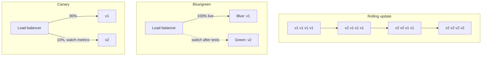

# CI/CD: Deployment Strategies and Rollback

> Continuous delivery end to end, zero-downtime rolling, blue-green and canary releases, high-frequency deploys, and rollback design.

## Key Concepts

### Rolling vs. Blue/Green vs. Canary

All three strategies replace version 1 with version 2 without downtime; they differ in how much traffic is at risk and how fast you can go back. Rolling is the cheapest, blue/green gives the fastest rollback, and canary limits the blast radius best.



| Strategy | Extra capacity | Rollback speed | Users exposed to a bad version |
| --- | --- | --- | --- |
| Rolling | Small (`maxSurge`) | Slow: roll back Pod by Pod | Grows as the rollout progresses |
| Blue/green | Double, for a short time | Instant: switch traffic back | All users, after the switch |
| Canary | Small | Fast: send the canary's traffic back to v1 | Only the canary share, for example 10% |

## Interview Questions

<details><summary>Q1. [Intermediate] Explain a complete CD process.</summary>

**Answer:**

CD starts from an approved, versioned artifact. The system deploys it to a lower environment, runs schema and policy checks plus integration and smoke tests, then promotes that same digest through each protected environment.

Production uses rolling, canary, or blue-green delivery depending on the risk.

Health gates watch readiness, error rate, latency, saturation — meaning how close a resource is to its limit — and key business transactions. Every deployment record includes the artifact digest, configuration version, approver, and a link to the change. If any limit is exceeded, traffic stops or rolls back.

Database changes stay backward compatible and are kept separate from any destructive cleanup step. After deploying, I watch a defined observation window, complete the audit trail, and keep a tested failback path ready.

</details>

<details><summary>Q2. [Intermediate] Zero-downtime deployments in Jenkins / GitHub Actions <em>(asked in interview round)</em></summary>

- **Rolling update** (the Kubernetes default): new pods come up and pass their readiness check before old pods are terminated. `maxUnavailable` and `maxSurge` control how aggressive this is. Use PodDisruptionBudgets too.
- **Blue/Green:** stand up the new version next to the old one, then switch traffic over once it's healthy. Rollback is instant — just switch back.
- **Canary:** send a small percentage of traffic to the new version, watch the metrics, then ramp up gradually.
- **What actually enables this, regardless of tool:** readiness and liveness probes, graceful shutdown (handling SIGTERM and using `preStop`), backward-compatible database migrations (the expand/contract pattern), and only promoting once health checks pass. The CI tool just triggers these steps — the real zero-downtime behavior lives in how the deployment target is set up.

</details>

<details><summary>Q3. [Intermediate] How do you implement zero-downtime deployments in Jenkins or GitHub Actions?</summary>

**Answer:**

The pipeline picks rolling, blue-green, or canary delivery. The workload needs multiple replicas spread across failure domains — groups of resources that could fail together — realistic readiness and startup probes, enough spare capacity, graceful shutdown, and connection draining.

New versions need backward-compatible APIs, config, and database schema.

The pipeline deploys to a small slice first, runs smoke and synthetic tests, and watches error rate, latency, saturation, and business metrics. Traffic only increases once those checks pass. If they decline, it stops and routes back to the previous version.

I load-test the strategy itself and simulate a failed readiness check and a rollback. "Zero downtime" is an availability goal that the architecture has to support — adding a deploy command alone doesn't guarantee it.

</details>

<details><summary>Q4. [Intermediate] How do you implement rolling updates with minimum downtime? <em>(scenario)</em></summary>

**Answer:** Configure the Kubernetes deployment strategy, and set `maxUnavailable=0` and `maxSurge=1`.

**Detailed interview approach:**
I use a Deployment strategy with realistic readiness and startup probes, graceful shutdown, and enough spare capacity. `maxUnavailable` and `maxSurge` are chosen based on the replica count and the availability target — setting zero unavailable only makes sense if the cluster can actually host the surge.

I deploy an image by its fixed digest, so the version can't shift underneath the rollout. I watch `kubectl rollout status`, Pod events, error rate, latency, and business checks, and pause if the new ReplicaSet looks unhealthy. Rolling back means either `kubectl rollout undo deployment/<name>` or a Git revert in a GitOps setup, followed by verification.

PodDisruptionBudgets, spreading pods across multiple zones, backward-compatible configuration and database changes, and a tested rollback path are what actually make the update low-risk.

</details>

<details><summary>Q5. [Intermediate] Blue/Green vs Canary — when to choose which <em>(asked in interview round)</em></summary>

- **Blue/Green:** you run two full environments and cut traffic over all at once. Choose this when you need an instant rollback and can afford double the capacity — for example, major releases where testing on a full parallel environment matters. Downside: cost, and all users move at the same time.
- **Canary:** you gradually shift a small slice of traffic to the new version while watching metrics. Choose this when you want to limit the blast radius, validate against real production traffic, and roll changes out gradually. It needs good metrics and automation to work well. Downside: more complex routing, and a slower full rollout.
- Rule of thumb: canary for continuous, risk-managed delivery of high-traffic services; blue-green for big-bang releases that need an instant switch.

</details>

<details><summary>Q6. [Advanced] How do you manage blue-green deployments for APIs? <em>(scenario)</em></summary>

**Answer:** Run two versions behind a load balancer, route traffic gradually, and use Apigee or Azure API Gateway for traffic splitting.

**Detailed interview approach:**
I pick a delivery strategy based on risk: rolling for routine stateless changes, canary when I want metric-based exposure, or blue-green when I need a fast traffic switch. Whichever one I use, the artifact itself never changes once built.

The pipeline runs prechecks, deploys to a small or no-traffic target, runs readiness and business smoke tests, then advances gradually while watching error rate, latency, saturation — meaning how close a resource is to its limit — and the SLO or error budget.

If any threshold fails, it stops traffic and rolls back to the previous artifact or config. Database changes use the expand-and-contract pattern, because rolling back the application can't undo a destructive schema change. I verify recovery, record what happened, and improve whichever test or guard should have caught the failure earlier.

</details>

<details><summary>Q7. [Intermediate] What deployment strategies have you used (e.g., Blue-Green, Canary, Rolling updates)? <em>(scenario)</em></summary>

**Answer:** Rolling updates for stateless apps. Blue-green, switching a Service selector, for critical services. Canary with ALB traffic splitting for high-traffic services. ArgoCD's progressive sync with automatic rollback on top of all of it.

**Detailed interview approach:**
In EKS environments managed by ArgoCD, I mainly use rolling updates for stateless applications, with Kubernetes Deployments backed by proper health checks and readiness probes.

For critical services, I've used blue-green deployments, where a Kubernetes Service switches its selector between two deployment sets once the new one passes health checks.

For high-traffic services, I use canary deployments with traffic splitting through the AWS ALB Ingress Controller — starting at 5% traffic to the new version, and increasing it gradually based on error rates and latency from CloudWatch.

ArgoCD's progressive sync features help automate all of this, with automatic rollback if health checks fail mid-deployment.

</details>

<details><summary>Q8. [Advanced] A team deploys 50 times per day. How do you maintain stability without slowing releases?</summary>

**Answer:**

I make every change small, independently testable, observable, and reversible. Trunk-based development or short-lived branches, required automated tests, static and security policy checks, immutable artifacts, and reliable ephemeral test environments all give fast feedback.

High-risk code gets separated from the release itself using feature flags, with clear ownership and an expiry date.

Deployment uses canary or progressive rollout, with automated analysis of error rate, latency, saturation, and business metrics, and automatic pause or rollback. Changes keep backward-compatible APIs and expand-and-contract database migrations.

Service ownership, SLOs, error budgets, runbooks, and on-call readiness decide when the release rate is actually safe. A depleted error budget can mean pausing for reliability work — but that shouldn't become a permanent manual gate.

I track change failure rate, lead time, deployment frequency, recovery time, flaky tests, and rollback success. Delivery is fast and stable when the pipeline catches bad changes early and production limits the blast radius — not when reviews or tests get skipped.

</details>

<details><summary>Q9. [Intermediate] How do you roll back a faulty deployment?</summary>

**Answer:**

First I stop the rollout and decide whether rolling back is actually safer than fixing forward. For a stateless application, rollback just points traffic or the deployment controller back at the previous artifact, which stays immutable the whole time.

I check that the old configuration is still compatible, then run smoke tests and watch monitoring.

For canary or blue-green, I shift traffic back quickly. On Kubernetes, I might use a Helm revision or a Deployment rollback. Database and schema changes need their own recovery plan — rolling back the application can't undo a destructive migration.

I preserve the logs and the failed version, communicate status, confirm users have actually recovered, and run a root-cause analysis. Prevention might mean better probes, tighter canary thresholds, backward-compatible schemas, or an integration test we were missing.

</details>

<details><summary>Q10. [Advanced] How do you design rollback so it still works when the deployment stage itself fails?</summary>

**Answer:**

I design rollback before deployment even happens, and it runs from a separate, protected recovery path — not just as the next command in a job that already failed. I store the last known-good artifact — image, chart, or config version — and its deployment metadata outside the agent's own workspace.

The deployment system uses timeouts and `post`/`finally` handling, but an operator or an automated health controller can also trigger a dedicated rollback job with its own independent credentials.

On Kubernetes I use a Git revert, a Helm rollback, or a progressive-delivery controller. For VM deployments, I keep the previous package or image around and rotate traffic back to it. Database changes use the expand-and-contract pattern, because rolling back application code can't undo an incompatible, destructive schema change.

The recovery workflow is idempotent, meaning it's safe to run more than once. It's also scoped to one environment, audited, and gated by approval for production.

I test failure at checkout, artifact download, partial rollout, health check, and notification stages. After a rollback, I verify the real customer transaction, error and latency metrics, the version running on every instance, database compatibility, and any queue or background workers.

Then I preserve the evidence and fix the failed release properly, rather than just retrying it over and over.

</details>

<details><summary>Q11. [Intermediate] How do you implement CI/CD rollbacks automatically? <em>(scenario)</em></summary>

**Answer:** The pipeline detects the failure, triggers `kubectl rollout undo` or redeploys the last known-good artifact, and notifies the team.

**Detailed interview approach:**
I pick a delivery strategy based on risk: rolling for routine stateless changes, canary when I want metric-based exposure, or blue-green when I need a fast traffic switch. The artifact itself never changes once built.

The pipeline runs prechecks, deploys to a small or no-traffic target, runs readiness and business smoke tests, then advances gradually while watching error rate, latency, saturation, and the SLO or error budget.

If any threshold fails, it stops traffic and rolls back to the previous artifact or config. Database changes use the expand-and-contract pattern, because rolling back the application can't undo a destructive schema change. I verify recovery, record what happened, and improve whichever test or guard should have caught the failure earlier.

</details>

<details><summary>Q12. [Intermediate] How do you ensure rollback in case of deployment failure? <em>(scenario)</em></summary>

**Answer:** Use Terraform's state history and version control for infrastructure. Use ArgoCD's deployment history and automated health checks for applications. Redeploy a known-good SHA-tagged image, and keep database migrations backward compatible.

**Detailed interview approach:**
For infrastructure managed by Terraform, I keep state history and version control, so I can revert to a previous commit and apply it. For Kubernetes applications, ArgoCD keeps a history of successful deployments and their manifests.

I set up automated health checks that ArgoCD uses to judge whether a deployment succeeded. If something fails, I use ArgoCD's rollback feature to go back to the last successful deployment, or trigger a GitHub Actions workflow to reapply a previous infrastructure state.

Because CI tags every image with its Git SHA, redeploying a specific known-good version is straightforward. For database changes, I use migrations that support rollback and stay backward compatible across adjacent versions.

</details>

<details><summary>Q13. [Intermediate] Which deployment strategies have you used? Explain Rolling, Blue-Green and Canary with project examples. <em>(asked in interview round)</em></summary>

**Answer:**

I choose the strategy based on risk and cost. Rolling update is the default for most stateless services. Blue-Green is for releases where I need an instant switch and an instant rollback. Canary is for high-traffic, high-risk services where I want to expose the new version to a small percentage of real users first and watch metrics.

**Comparison:**

| Strategy | How it works | Rollback | Extra cost | When I use it |
| --- | --- | --- | --- | --- |
| Rolling | Replaces Pods gradually (`maxSurge`, `maxUnavailable`) | `kubectl rollout undo`, takes minutes | Very little | Most stateless APIs and workers |
| Blue-Green | Full new stack (green) next to old (blue), then switch all traffic | Switch the selector or listener back, seconds | Double capacity during release | Payment or checkout services, big framework upgrades |
| Canary | Send 5%, 25%, 50%, 100% of traffic to the new version with analysis between steps | Abort and send 100% back to stable | Small | User-facing services with good metrics |

**Flow diagrams:**

```text
Rolling:    v1 v1 v1 v1  ->  v2 v1 v1 v1  ->  v2 v2 v1 v1  ->  v2 v2 v2 v2

Blue-Green: Service --> blue (v1)          green (v2) tested privately
            Service --> green (v2)         blue (v1) kept for rollback

Canary:     95% -> stable v1 | 5% -> canary v2 --> check error rate / latency
            75% -> v1 | 25% -> v2 --> check --> 100% -> v2
```

**Example: rolling update settings:**

```yaml
spec:
  replicas: 4
  strategy:
    type: RollingUpdate
    rollingUpdate:
      maxSurge: 1          # at most 5 Pods during the rollout
      maxUnavailable: 0    # never drop below 4 ready Pods
  minReadySeconds: 10
```

**Example: canary with Argo Rollouts:**

```yaml
apiVersion: argoproj.io/v1alpha1
kind: Rollout
metadata:
  name: orders-api
spec:
  replicas: 5
  strategy:
    canary:
      canaryService: orders-api-canary
      stableService: orders-api-stable
      trafficRouting:
        alb:
          ingress: orders-api
          servicePort: 80
      steps:
        - setWeight: 10
        - pause: {duration: 10m}
        - analysis:
            templates:
              - templateName: error-rate
        - setWeight: 50
        - pause: {duration: 10m}
  selector:
    matchLabels:
      app: orders-api
  template:
    metadata:
      labels:
        app: orders-api
    spec:
      containers:
        - name: orders-api
          image: 123456789012.dkr.ecr.us-east-1.amazonaws.com/orders-api:1.8.0
```

**Project examples (adapt to your own):**

- **Rolling:** internal REST APIs and queue consumers deployed through Helm and Argo CD with `maxUnavailable: 0` and readiness probes.
- **Blue-Green:** a payments service where we deployed green, ran smoke tests through a preview Service, then switched the Service selector (or ALB weighted target groups) and kept blue for one hour.
- **Canary:** a customer-facing search API using Argo Rollouts with ALB traffic splitting, automatically aborted when the 5xx rate went above 1% in Prometheus.

**Important points:**

- All strategies depend on correct readiness probes; otherwise traffic reaches Pods that are not ready.
- Database schema changes must be backward compatible (expand and contract) for Blue-Green and Canary, because both versions run at the same time.
- Canary needs good metrics and automated analysis; without them it is just a slow rolling update.

See also: [deployment strategies and rollback](../ci-cd/04-deployment-strategies-and-rollback.md) and [Kubernetes deployments and upgrades](../kubernetes/07-deployments-upgrades-cicd.md).

**Interview-ready answer:**

> "I have used all three. Rolling update is my default for stateless services, with `maxUnavailable: 0`, `maxSurge: 1` and proper readiness probes so capacity never drops. For a payments service we used Blue-Green: we deployed the green version alongside blue, ran smoke tests on a preview Service, switched traffic in one step and kept blue running for an hour so rollback was just switching back. For a high-traffic customer API we used canary with Argo Rollouts and ALB traffic splitting, moving from 10% to 50% to 100% with Prometheus analysis on error rate and latency between steps. In all cases I keep database changes backward compatible because old and new versions run together."

</details>

<details><summary>Q14. [Advanced] During a Blue-Green release, what happens to old Pods, ongoing requests and live traffic when traffic switches? <em>(asked in interview round)</em></summary>

**Answer:**

When traffic switches from blue to green, **new** requests go to green immediately, but requests already in flight on blue must be allowed to finish. Blue Pods are not deleted at the moment of the switch; they stay running for a rollback window, and when they are finally removed they are drained gracefully.

**What happens at the switch:**

```text
Before:  Users --> ALB / Service --> blue Pods (v1)
Switch:  Service selector or ALB listener now points to green
         |
         |-- New connections  --> green Pods (v2)
         |-- In-flight requests on blue --> finish on blue
         |-- Keep-alive connections to blue --> closed after the current request
         |                                     (or after idle / drain timeout)
         v
After:   blue Pods stay running, receive no new traffic (rollback window)
         later: scale blue to 0 --> graceful termination
```

**Graceful termination sequence for a blue Pod:**

```text
Pod deleted
  |-- Pod marked Terminating, removed from EndpointSlices (in parallel)
  |-- preStop hook runs (e.g. sleep 15) so kube-proxy and the ALB
  |   stop sending new traffic before the app shuts down
  |-- SIGTERM sent to the container --> app stops accepting, finishes in-flight work
  |-- terminationGracePeriodSeconds expires --> SIGKILL if still running
```

**Example configuration:**

```yaml
spec:
  terminationGracePeriodSeconds: 60
  containers:
    - name: payments
      image: 123456789012.dkr.ecr.us-east-1.amazonaws.com/payments:2.4.0
      lifecycle:
        preStop:
          exec:
            command: ["sh", "-c", "sleep 15"]
      readinessProbe:
        httpGet:
          path: /ready
          port: 8080
        periodSeconds: 5
```

With the AWS Load Balancer Controller and IP targets, also set the target group deregistration delay so the ALB drains connections:

```yaml
metadata:
  annotations:
    alb.ingress.kubernetes.io/target-group-attributes: deregistration_delay.timeout_seconds=30
```

**Checklist for a safe switch:**

1. Green Pods are fully Ready (readiness probe passing) and smoke-tested through a preview Service before the switch.
2. Switch traffic in one step: change the Service selector from `version: blue` to `version: green`, or change ALB weighted target groups.
3. Watch error rate, latency and logs on green.
4. Keep blue running at full size for the rollback window (for example 30 to 60 minutes).
5. Scale blue down; `preStop`, `terminationGracePeriodSeconds` and the deregistration delay let in-flight requests finish.
6. Database: green and blue share the database, so the schema must work for both (add columns first, remove old ones in a later release).

**Important points:**

- Long-lived connections (WebSockets, gRPC streams, HTTP keep-alive) stay on blue until they close, so the app should close idle keep-alive connections after SIGTERM.
- The `preStop` sleep covers the delay between endpoint removal and load balancer or kube-proxy updates.
- `terminationGracePeriodSeconds` must be longer than `preStop` plus the time the app needs to finish requests.
- Sessions stored in memory are lost when blue goes away; store sessions in Redis or use stateless tokens.
- Background jobs and queue consumers on blue must stop consuming and finish or release messages.

**Interview-ready answer:**

> "When we switch from blue to green, only new requests go to green; requests already running on blue finish there. We do not delete blue at the switch. It stays running for a rollback window, so if green has problems we simply point the selector or ALB back to blue. When we later scale blue down, each Pod is removed from the endpoints, the `preStop` sleep gives the load balancer and kube-proxy time to stop sending traffic, then the app gets SIGTERM and finishes in-flight requests within `terminationGracePeriodSeconds`. On the ALB we set a deregistration delay so connections drain. We also keep database changes backward compatible because both versions share the same database during the release."

</details>

<details><summary>Q15. [Intermediate] How do you implement zero-downtime deployment? <em>(asked in interview round)</em></summary>

**Answer:**

Zero downtime means users never hit an instance that is starting, stopping or broken. It requires three things together: a deployment strategy that keeps capacity available, correct health checks and graceful shutdown, and backward-compatible changes (especially the database).

**Steps:**

1. Run at least two replicas behind a load balancer or Kubernetes Service.
2. Use a rolling update with `maxUnavailable: 0` and `maxSurge: 1` (or blue-green/canary for higher-risk changes).
3. Add a **readiness probe** so traffic only goes to Pods that are ready, and a **startup probe** for slow starters.
4. Handle graceful shutdown: on `SIGTERM`, stop accepting new requests, finish in-flight requests, then exit. Add a short `preStop` delay so endpoints are removed before the process stops.
5. Make database changes backward compatible using expand-and-contract: add columns first, deploy code that works with both schemas, remove old columns later.
6. Protect capacity with a `PodDisruptionBudget` during node maintenance.
7. Verify with smoke tests and metrics, and roll back automatically if error rates rise.

**Flow:**

```text
v1 x3 serving
   |
   v
Create v2 Pod (surge) --> startup/readiness probe passes --> added to Service endpoints
   |
   v
Terminate one v1 Pod --> removed from endpoints --> preStop sleep --> SIGTERM --> drain --> exit
   |
   v
Repeat until v2 x3; monitor error rate and latency; rollback if SLO is breached
```

**Kubernetes example:**

```yaml
spec:
  replicas: 3
  strategy:
    type: RollingUpdate
    rollingUpdate:
      maxUnavailable: 0
      maxSurge: 1
  template:
    spec:
      terminationGracePeriodSeconds: 45
      containers:
        - name: api
          image: myregistry/api:1.4.2
          readinessProbe:
            httpGet: { path: /ready, port: 8080 }
            periodSeconds: 5
          startupProbe:
            httpGet: { path: /health, port: 8080 }
            failureThreshold: 30
            periodSeconds: 5
          lifecycle:
            preStop:
              sleep:
                seconds: 10
```

The native `preStop` `sleep` action is available from Kubernetes 1.30 onward (beta and enabled by default); on older clusters use `exec: { command: ["sleep", "10"] }`, which needs a `sleep` binary in the image.

**Important points:**

- Readiness should check that the app can serve, not every downstream dependency, or one slow dependency will remove all Pods.
- Long-lived connections (WebSockets, gRPC streams) need connection draining on the load balancer.
- Database migrations are the most common reason "zero downtime" fails.

See also: [Zero-downtime deployment](../repetitive-questions/zero-downtime-deployment.md), [Deployment strategies and rollback](../ci-cd/04-deployment-strategies-and-rollback.md), [Kubernetes deployments and upgrades](../kubernetes/07-deployments-upgrades-cicd.md)

**Interview-ready answer:**

> "I combine a safe rollout strategy, correct health handling and backward-compatible changes. In Kubernetes I use a rolling update with `maxUnavailable: 0` and `maxSurge: 1`, so capacity never drops, and readiness and startup probes so traffic only reaches Pods that are ready. For shutdown I add a short `preStop` delay and handle `SIGTERM` gracefully so in-flight requests complete. Database changes follow expand-and-contract, so old and new versions both work during the rollout. I add a PodDisruptionBudget, run smoke tests after the rollout, and roll back automatically if error rate or latency breaches the threshold. For risky changes I use blue-green or canary instead of a plain rolling update."

</details>

<details><summary>Q16. [Basic] Blue-Green vs Canary deployment? <em>(asked in interview round)</em></summary>

**Answer:**

Both reduce release risk, but they control it differently. **Blue-green** runs two full environments and switches all traffic at once, with instant rollback. **Canary** sends a small percentage of real traffic to the new version and increases it gradually based on metrics.

**Comparison:**

| Aspect | Blue-green | Canary |
| --- | --- | --- |
| Traffic shift | All at once (0% to 100%) | Gradual (for example 5%, 25%, 50%, 100%) |
| Rollback | Instant: switch back to blue | Shift traffic back; few users affected |
| Infrastructure cost | Double capacity during release | Small extra capacity |
| Blast radius | All users after the switch | Only the canary percentage |
| Needs | Load balancer or DNS switch, environment parity | Traffic splitting (service mesh, ingress, ALB weights) and good metrics |
| Best for | Releases needing full pre-production verification, easy rollback | High-traffic services where real-user validation matters |

**Flow:**

```text
Blue-green:                                Canary:
Blue (v1) <- 100% traffic                  v1 <- 95%   v2 <- 5%
Deploy Green (v2), test privately               | metrics OK?
Switch LB/Service to Green                 v1 <- 75%   v2 <- 25%
Keep Blue for fast rollback                     | metrics OK?
                                           v2 <- 100%  (abort and revert if SLO breached)
```

**Example: Argo Rollouts canary:**

```yaml
strategy:
  canary:
    steps:
      - setWeight: 10
      - pause: { duration: 5m }
      - analysis:
          templates:
            - templateName: error-rate-check
      - setWeight: 50
      - pause: { duration: 10m }
```

**Important points:**

- Both strategies need backward-compatible database changes, because two versions run at the same time.
- Canary is only as good as its metrics; without error-rate and latency analysis it is just a slow rollout.
- Blue-green rollback is only instant if the old environment is kept running and nothing irreversible (like a destructive migration) has happened.

See also: [Deployment strategies and rollback](../ci-cd/04-deployment-strategies-and-rollback.md), [Kubernetes deployments and upgrades](../kubernetes/07-deployments-upgrades-cicd.md), [Service mesh with Istio](../kubernetes/10-service-mesh-istio.md)

**Interview-ready answer:**

> "Blue-green runs two identical environments: I deploy the new version to green, test it, then switch all traffic from blue to green, and rollback is just switching back. It gives instant rollback but needs double capacity and exposes all users at once after the switch. Canary releases the new version to a small percentage of real traffic and increases it in steps while automated analysis checks error rate and latency. It has a smaller blast radius and lower cost, but needs traffic splitting and good observability. I choose blue-green when I want full verification and instant rollback, and canary for high-traffic services where real-user validation matters. Both require backward-compatible database changes."

</details>

<details><summary>Q17. [Intermediate] How do you safely roll back a failed release? <em>(asked in interview round)</em></summary>

**Answer:**

A safe rollback redeploys a known-good, immutable artifact quickly and predictably. It must be planned before the release: the previous version must still exist, the database must still be compatible with it, and the rollback path must be tested.

**Steps:**

1. **Decide quickly**: if the release breaches an SLO or error threshold, roll back first and debug later.
2. **Identify the last known-good version** (image digest, Helm revision, Git tag).
3. **Roll back using the same mechanism** used to deploy:
   - Kubernetes: `kubectl rollout undo`.
   - Helm: `helm rollback <release> <revision>`.
   - GitOps: revert the commit in the config repository and let Argo CD or Flux sync.
   - Blue-green: switch traffic back.
   - Feature flags: turn the feature off without redeploying.
4. **Check the database**: if a migration ran, confirm the old code works with the new schema (expand-and-contract), or run a tested down-migration.
5. **Verify**: error rate, latency, logs and smoke tests back to normal.
6. **Freeze and investigate**: block further deploys of the bad version and run a post-incident review.

**Decision flow:**

```text
Release unhealthy?
      |
      v
Feature-flagged? --yes--> disable flag --> verify
      |no
      v
Schema change irreversible? --yes--> roll forward with a fix (rollback would break)
      |no
      v
Redeploy previous artifact (undo / helm rollback / Git revert / switch LB)
      |
      v
Verify metrics + smoke tests --> post-incident review
```

**Commands:**

```bash
kubectl rollout history deployment/api -n prod
kubectl rollout undo deployment/api -n prod --to-revision=12
kubectl rollout status deployment/api -n prod

helm history api -n prod
helm rollback api 7 -n prod --wait --timeout 10m

git revert <bad-commit-sha> && git push    # GitOps repository
```

**Important points:**

- Never rebuild the old version for a rollback; redeploy the exact old artifact by digest.
- In GitOps, a `kubectl` rollback is overwritten by the next sync; roll back in Git.
- Sometimes rolling forward is safer, for example after an irreversible migration or a security fix.

See also: [Rollback strategy](../repetitive-questions/rollback-strategy.md), [Deployment strategies and rollback](../ci-cd/04-deployment-strategies-and-rollback.md), [Jenkins Kubernetes deployments and rollback](../jenkins/04-kubernetes-deployments-and-rollback.md)

**Interview-ready answer:**

> "I plan rollback before the release: every build produces an immutable artifact, the previous version is retained, and database changes are backward compatible. When a release breaches the error or latency threshold, I roll back first and debug later. I use the same mechanism I deployed with: `helm rollback`, `kubectl rollout undo`, a Git revert for GitOps, switching traffic back in blue-green, or disabling a feature flag. Before rolling back I check whether a migration ran, because if it is irreversible a roll-forward fix can be safer. After rollback I verify metrics and smoke tests, block the bad version, and run a blameless review."

</details>

<details><summary>Q18. [Advanced] How do you implement rollback, artifact promotion and zero-downtime deployments with Jenkins, GitHub Actions or GitLab CI? <em>(asked in interview round)</em></summary>

**Answer:**

The pattern is the same in every tool: **build once, promote the same immutable artifact through environments, deploy with a health-checked strategy, and roll back automatically to the previous artifact if verification fails.** Only the syntax changes.

**Flow:**

```text
Commit --> CI: build, test, scan --> push image tagged with Git SHA (record digest)
                                         |
                                         v
                    Deploy to dev --> tests --> Deploy to staging --> tests
                                         |
                                         v
                        Manual approval (protected environment)
                                         |
                                         v
          Deploy SAME digest to prod (rolling/canary, --wait) --> smoke test
                                         |
                       healthy? --no--> automatic rollback to previous revision
```

**GitHub Actions:**

```yaml
jobs:
  build:
    runs-on: ubuntu-latest
    outputs:
      tag: ${{ github.sha }}
    steps:
      - uses: actions/checkout@v4
      - run: |
          docker build -t "$REGISTRY/api:${GITHUB_SHA}" .
          docker push "$REGISTRY/api:${GITHUB_SHA}"

  deploy-prod:
    needs: build
    runs-on: ubuntu-latest
    environment: production          # required reviewers configured on the environment
    concurrency: deploy-prod
    steps:
      - uses: actions/checkout@v4
      - run: |
          set -euo pipefail
          if ! helm upgrade --install api ./chart -n prod \
               --set image.tag="${{ needs.build.outputs.tag }}" \
               --wait --timeout 10m; then
            helm rollback api 0 -n prod --wait   # 0 = previous revision
            exit 1
          fi
          ./scripts/smoke-test.sh || { helm rollback api 0 -n prod --wait; exit 1; }
```

**Jenkins (declarative):**

```groovy
stage('Promote to prod') {
  input { message 'Deploy to production?' }
  steps {
    sh '''
      set -euo pipefail
      helm upgrade --install api ./chart -n prod --set image.tag=${GIT_COMMIT} --wait --timeout 10m
      ./scripts/smoke-test.sh
    '''
  }
  post {
    failure { sh 'helm rollback api 0 -n prod --wait' }
  }
}
```

**GitLab CI:**

```yaml
deploy_prod:
  stage: deploy
  environment:
    name: production
  when: manual
  resource_group: production
  script:
    - helm upgrade --install api ./chart -n prod --set image.tag=$CI_COMMIT_SHA --wait --timeout 10m
    - ./scripts/smoke-test.sh || (helm rollback api 0 -n prod --wait && exit 1)
```

**Important points:**

- Promotion means moving the same artifact (ideally by digest), not rebuilding per environment.
- Environment-specific configuration lives outside the image (values files, ConfigMaps, secret stores).
- Use protected environments and approvals for production, and serialise deploys (`concurrency`, `resource_group`, `lock()` in Jenkins).
- With Helm 4, `--rollback-on-failure` (the replacement for Helm 3's `--atomic`) can perform the rollback for you; an explicit rollback step keeps the behaviour visible in the pipeline.
- In a GitOps model, the pipeline only updates the image tag in the config repository, and rollback is a Git revert.

See also: [Environments, promotion and approvals](../ci-cd/03-environments-promotion-and-approvals.md), [Jenkins pipeline design, approvals and artifacts](../jenkins/03-cicd-pipeline-design-approvals-and-artifacts.md), [GitHub Actions pipelines and troubleshooting](../github-actions/03-end-to-end-pipelines-security-and-troubleshooting.md), [Sample pipelines](../repetitive-questions/sample-pipelines-examples.md)

**Interview-ready answer:**

> "Whatever the tool, I build the image once, tag it with the commit SHA and promote that same artifact through dev, staging and production. Environment differences live in values files and secret stores, not in the image. Production is a protected environment with an approval, and deployments are serialised with `concurrency` in GitHub Actions, `resource_group` in GitLab or a lock in Jenkins. I deploy with Helm using `--wait`, so the job only passes when Pods are ready, then run smoke tests. If either fails, the pipeline runs `helm rollback` to the previous revision automatically. For zero downtime the chart uses rolling updates with readiness probes and graceful shutdown, and for riskier services I use canary with automated analysis."

</details>

<details><summary>Q19. [Advanced] A production deployment causes a sudden spike in 5xx errors. How do you diagnose, mitigate and roll back? <em>(asked in interview round)</em></summary>

**Answer:**

When errors spike right after a deployment, the deployment is the prime suspect. My priority is to **restore service first** by rolling back, then diagnose with the evidence I preserved.

**Steps:**

1. **Confirm and scope** (1 to 2 minutes): error rate and which endpoints; does the spike start exactly at the deploy time? Only new-version Pods or all of them?
2. **Declare an incident**, notify stakeholders, pause any further rollouts (`kubectl rollout pause`, stop the canary, freeze the pipeline).
3. **Mitigate**:
   - Canary: abort and shift traffic back to stable.
   - Blue-green: switch traffic back to blue.
   - Feature flag: turn it off.
   - Rolling update: `helm rollback` or `kubectl rollout undo` to the last good revision.
4. **Verify recovery**: 5xx rate back to baseline, latency normal, SLO burn stopped.
5. **Diagnose** with preserved evidence: logs from the new Pods, traces of failing requests, diff between releases (code, config, secrets, dependencies, migrations).
6. **Fix forward safely**: fix, test in staging, redeploy with canary.
7. **Post-incident review**: why tests and canary analysis did not catch it.

**Decision flow:**

```text
5xx spike after deploy
      |
      v
Correlates with deploy time and new version? --no--> check dependencies/infra (Q15, Q26)
      |yes
      v
Pause rollout --> feature flag? --yes--> disable flag
      |no
      v
DB migration irreversible? --yes--> roll forward with hotfix / compatible patch
      |no
      v
Rollback (canary abort / switch blue / helm rollback / Git revert)
      |
      v
Verify metrics --> diagnose from evidence --> fix --> canary redeploy --> RCA
```

**Commands:**

```bash
kubectl rollout pause deployment/api -n prod
kubectl get pods -n prod -l app=api -L app.kubernetes.io/version
kubectl logs -n prod -l app=api,app.kubernetes.io/version=2.4.0 --since=15m --prefix | grep -iE 'error|exception' | tail -50

helm history api -n prod
helm rollback api -n prod --wait --timeout 10m       # previous revision
kubectl rollout status deployment/api -n prod

# Argo Rollouts canary
kubectl argo rollouts abort api -n prod

# GitOps
git revert <deploy-commit> && git push
```

```promql
sum by (version) (rate(http_requests_total{job="api",code=~"5.."}[1m]))
  / sum by (version) (rate(http_requests_total{job="api"}[1m]))
```

**Important points:**

- Do not debug in production while users are failing; roll back first if the deployment correlates.
- Comparing error rate by version label instantly confirms whether the new version is the cause.
- Automatic canary analysis and post-deploy smoke tests are the long-term fix for this scenario.

See also: [Rollback strategy](../repetitive-questions/rollback-strategy.md), [Deployment strategies and rollback](../ci-cd/04-deployment-strategies-and-rollback.md), [Production issues](../repetitive-questions/production-issues.md), [SRE](../ops/03-sre.md)

**Interview-ready answer:**

> "If 5xx errors spike right after a deployment, I treat the deployment as the main suspect and focus on restoring service first. I confirm the timing and compare error rate by version label, which shows immediately whether the new version is responsible. I declare an incident, pause the rollout, and mitigate with the fastest safe option: disable the feature flag, abort the canary, switch blue-green back, or `helm rollback` to the last good revision. The only exception is an irreversible migration, where I roll forward with a fix. Once metrics are back to baseline, I diagnose from preserved logs and traces and diff the releases. The fix goes out through a canary, and the review covers why our tests and canary analysis missed it."

</details>

<details><summary>Q20. [Intermediate] How do you implement zero-downtime deployments in Jenkins or GitHub Actions? <em>(asked in interview round)</em></summary>

**Answer:**

The CI tool only orchestrates; zero downtime comes from the deployment target. In Kubernetes that means a rolling update that never removes capacity before the new Pods are ready, plus readiness probes, graceful shutdown and backward-compatible database changes.

1. Rolling update with `maxUnavailable: 0` and `maxSurge: 1` (or blue/green or canary for riskier releases).
2. Readiness probes so traffic only reaches ready Pods; `preStop` hook and `terminationGracePeriodSeconds` to drain connections.
3. Expand/contract database migrations so old and new versions can run together.
4. The pipeline waits for rollout status and rolls back automatically on failure.

```bash
kubectl set image deployment/orders orders=registry/orders:"${GIT_SHA}"
kubectl rollout status deployment/orders --timeout=300s || kubectl rollout undo deployment/orders
```

**Interview-ready answer:**

> Zero downtime is a property of the deployment strategy, not of Jenkins or GitHub Actions. I use rolling updates with `maxUnavailable: 0`, readiness probes and graceful shutdown so old Pods keep serving until new ones are ready. Database changes follow the expand/contract pattern so both versions are compatible. The pipeline gates on `kubectl rollout status` and runs `rollout undo` automatically if the rollout or smoke tests fail.

See also: [Zero-downtime deployments in Jenkins / GitHub Actions](../ci-cd/04-deployment-strategies-and-rollback.md), [Zero-downtime deployment](../repetitive-questions/zero-downtime-deployment.md)

</details>

<details><summary>Q21. [Intermediate] Blue/green vs canary — when would you choose each? <em>(asked in interview round)</em></summary>

**Answer:**

| | Blue/green | Canary |
| --- | --- | --- |
| How | Two full environments; switch all traffic at once | Shift a small percentage of traffic, then increase |
| Rollback | Instant switch back | Set weight back to zero |
| Cost | Double capacity during release | Small extra capacity |
| Risk exposure | All users after switch | Limited users first |
| Needs | Load balancer or Service switch | Traffic splitting (Istio, Argo Rollouts, ALB weights) and good metrics |

Choose blue/green when you need a clean, instant cutover and full pre-production testing on the real stack, or when the change cannot run side by side. Choose canary for high-traffic services where you want real-user validation with a small blast radius and have metrics to judge success automatically.

**Interview-ready answer:**

> Blue/green runs two full environments and flips all traffic at once, which gives instant rollback but doubles capacity during the release. Canary sends a small share of traffic to the new version and increases it while metrics stay healthy, so issues reach only a few users. I pick blue/green when I need an atomic cutover or cannot run mixed versions, and canary for high-traffic services with good observability. With Argo Rollouts or Istio the canary promotion and rollback can be fully automated from error rate and latency.

See also: [Blue/Green vs Canary](../ci-cd/04-deployment-strategies-and-rollback.md), [Canary in Kubernetes](../kubernetes/07-deployments-upgrades-cicd.md)

</details>
