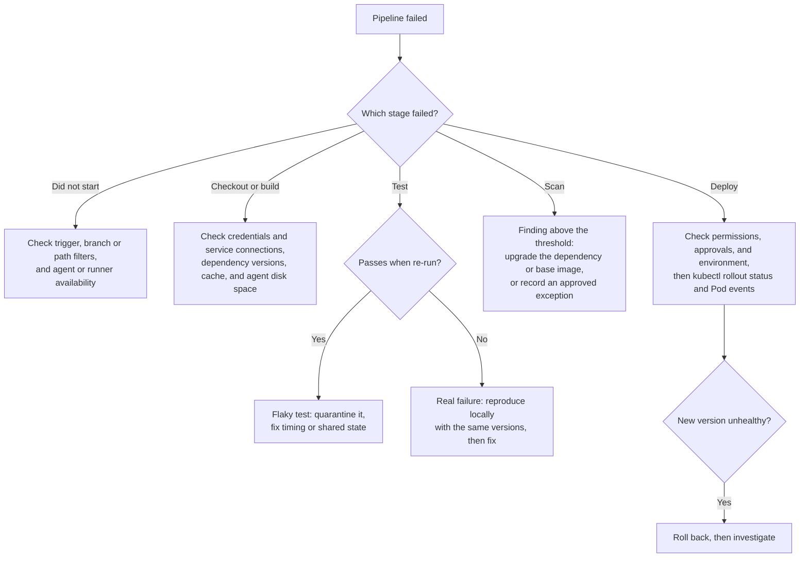

# CI/CD: Troubleshooting, Monitoring, and Operations

> Debugging failed and flaky pipelines, staging-vs-production differences, verifying deployments, notifications, and handling operational tickets.

## Key Concepts

### Failing Pipeline Decision Tree

Read the log of the first failed step, not the last one: later failures are often side effects. Then decide whether the failure is in your code, in the pipeline setup, or in the environment it deploys to.



## Interview Questions

<details><summary>Q1. [Intermediate] What happens when a pipeline fails? Give a real example.</summary>

**Answer:**

The pipeline stops any dependent stages, records logs and reports, marks the commit status, and notifies the owner. I figure out whether the failure is in the code, the test, the scanner, the runner, the credentials, the artifact, the network, or the target environment.

I don't just rerun it blindly — that hides flaky behavior instead of fixing it.

One real example: Trivy blocked an image because of a critical OpenSSL vulnerability in the base image. I confirmed the CVE and which version fixed it, updated the pinned base image, rebuilt from a clean cache, rescanned, ran regression tests, and published a new immutable digest.

Production was never reached.

Afterward, we scheduled regular base-image updates, assigned ownership for vulnerability exceptions, started retaining SBOMs, and built a dashboard to track aging critical findings.

</details>

<details><summary>Q2. [Intermediate] How do you debug CI/CD pipeline flakiness? <em>(scenario)</em></summary>

**Answer:** Identify the tests that fail unpredictably, add retries with backoff (waiting longer between each retry), isolate shared resources, and watch job history trends.
Mini-case: A flaky integration test broke builds one time in ten. Containerizing the test database eliminated the shared-state issue.

**Detailed interview approach:**
I collect the failure rate by test, stage, agent image, time, and dependency, then reproduce it using the same commit and environment. I look for shared mutable test data, assumptions about timing or order, random seeds, dependence on external APIs, resource pressure, and race conditions.

Logs capture the seed, test ID, and container and dependency versions — but never secrets. I isolate databases and queues per run, freeze or inject time, mock unstable external calls, and wait on health conditions instead of using fixed sleeps.

A small, limited retry can help classify a known temporary issue, but it shouldn't just turn a failing test green without recording it. I only isolate a flaky test with an owner and an expiry date, then fix the real cause and track the flake rate until it hits zero.

</details>

<details><summary>Q3. [Intermediate] A deployment works in staging but fails in production. What differences do you compare?</summary>

**Answer:**

I compare the exact artifact digest and configuration commit first — rebuilding between environments would make this investigation unreliable.

Then I check identity and permissions, secret names and versions, network routes and firewall policy, DNS and certificates, database schema and data volume, feature flags, external endpoints, quotas, resource limits, replica counts, region or zone, runtime versions, admission policies, and any production-only proxy or service mesh.

I preserve the production error, deployment events, logs, metrics, traces, and an audit of what changed, then reproduce the issue with production-like configuration while keeping sensitive values protected. I avoid making random manual changes while investigating.

If the impact is still active, I pause or roll back and confirm recovery before testing any fix.

The long-term fix is environment parity where it's practical, explicit versioned differences where it isn't, promoting one immutable artifact everywhere, testing with production-like load and policy, validating the config schema, running preflight dependency checks, and detecting drift.

</details>

<details><summary>Q4. [Advanced] A deployment succeeded, but traffic still reaches the old version. Where do you start?</summary>

**Answer:**

First I verify the actual deployed artifact digest, the workload revision, and the real Pod or container image — I don't just trust a "success" message.

Then I trace the request path: DNS and CDN cache, the load balancer or ingress routing, the service selector and EndpointSlices, readiness, the rollout strategy and its traffic weights, service-mesh routing, and client or browser cache.

Common causes are a mutable tag resolving to something unexpected, a deployment template that never actually changed, old endpoints still marked ready, canary or blue-green routing still weighted toward the old revision, cache TTL, or a deploy that went to the wrong cluster or namespace.

I capture evidence, make the smallest reversible fix to routing or rollout, and confirm live requests are hitting the new version — using version headers or metrics — before closing the incident.

</details>

<details><summary>Q5. [Intermediate] How do you ensure deployments are successful, and what monitoring/logging tools do you use to detect failures? <em>(scenario)</em></summary>

**Answer:** ArgoCD monitors resource health. Liveness and readiness probes check the app itself. Prometheus, Grafana, and CloudWatch logs cover monitoring. Alertmanager and PagerDuty handle alerting. Post-deploy synthetic transaction jobs confirm things actually work, and failures trigger an automatic rollback.

**Detailed interview approach:**
Validating a deployment happens in layers. ArgoCD watches Kubernetes resources for a healthy state after applying manifests, and Kubernetes liveness and readiness probes check both infrastructure and application health.

For monitoring, I run Prometheus on EKS with Grafana dashboards for key metrics, while logs are centralized in CloudWatch and processed with CloudWatch Insights. Both the application and infrastructure expose custom metrics for business and technical KPIs.

Alerting is configured in Prometheus Alertmanager, integrated with PagerDuty for critical issues. After deploying, automated Kubernetes Jobs run synthetic transactions to check end-to-end functionality — and if any check fails, ArgoCD automatically rolls back to the last known-good state.

</details>

<details><summary>Q6. [Intermediate] How do you implement CI/CD notifications? <em>(scenario)</em></summary>

**Answer:** Integrate Jenkins or Azure DevOps with Slack, Teams, or email, and send success and failure alerts with logs.

**Detailed interview approach:**
I send notifications from the pipeline's completion or `post` step, and include the status, service, environment, commit, artifact, failed stage, owner, run URL, dashboard link, and next action. Secrets or raw logs never get copied into chat.

Success messages are grouped or limited, while production failures, approval waits, and rollback events route to the owning channel or on-call system based on severity. Webhook credentials live in the secret store, and delivery failures are monitored.

I test notification formatting and deduplication, and link back to the retained evidence. Chat is a communication channel, not the source of truth — the CI system and the change record hold the actual audit data.

</details>

<details><summary>Q7. [Basic] How do you manage a ServiceNow task assigned to you?</summary>

**Answer:**

I read the category, impact, urgency, SLA, requester, evidence, dependencies, and any approval requirements. I restate the expected outcome and ask focused questions if something's unclear. I prioritize by user and business impact and the SLA — not just the order tickets arrived in.

I document investigation timestamps, the commands and results I ran (without secrets), the changes made, validation steps, and communication. Risky changes go through change control with a rollback plan.

If I'm blocked, I update the ticket with the owner, the reason, the next action, and an expected time — I don't leave it silent.

I only close a ticket once the requester or a defined test confirms success. I link related incident, problem, or change records, and write a knowledge article or automation if the issue is likely to repeat.

</details>

<details><summary>Q8. [Intermediate] A CI/CD pipeline failed. What do you check? <em>(asked in interview round)</em></summary>

**Answer:**

I read the logs of the **first failed step** and classify the failure: code/test failure, dependency, credentials/permissions, agent/runner, configuration, or target environment. Then I compare with the last successful run to see what changed.

**Steps:**

1. **Find the failed stage and step** and read the full error, not just the last line.
2. **What changed since the last green run?** Code commit, pipeline YAML, dependency version, base image, secrets, agent image.
3. **Build/test failures:** reproduce locally with the same command and versions.
4. **Dependencies:** registry or network unreachable, package version removed, lock file mismatch.
5. **Credentials:** expired service connection, secret or token; missing RBAC/IAM permission; OIDC trust misconfigured.
6. **Runner/agent:** disk full, offline agent, missing tool, timeout, no capacity.
7. **Deployment stage:** target cluster/app is reachable, quota limits, image pull errors, failed health checks or Helm rollout.
8. **Flaky vs real:** re-run once; if it passes, still log the flaky test and fix it.
9. **Fix forward or roll back**, and add a check so it is caught earlier next time.

**Flow:**

```text
Pipeline failed
     |
     v
Which stage/step? Read the full log
     |
     v
Compare with last successful run (what changed?)
     |
     +--> Build/test error   -> reproduce locally, fix code
     +--> Dependency error   -> registry, version, network
     +--> Auth error (401/403) -> secret expiry, RBAC, service connection
     +--> Runner error       -> disk, tools, timeout, agent offline
     +--> Deploy error       -> cluster access, image pull, health checks
     |
     v
Fix -> re-run -> prevent (tests, alerts, pinned versions)
```

**Example (useful debugging):**

```bash
# GitHub Actions: view logs of a failed run
gh run list --limit 5
gh run view <run-id> --log-failed

# Kubernetes deploy stage failed
kubectl rollout status deploy/web -n app
kubectl describe pod -l app=web -n app
kubectl get events -n app --sort-by=.lastTimestamp
```

Enable step debug logging when needed: in GitHub Actions set the secret or variable `ACTIONS_STEP_DEBUG=true`; in Azure DevOps set the variable `system.debug=true`.

**Important points:**

- Pin versions (actions, base images, tools) so builds do not break because something upstream changed.
- Expired credentials are one of the most common "it worked yesterday" causes.
- Never fix a failure by disabling tests or security gates.

See also: [CI/CD troubleshooting](../ci-cd/07-troubleshooting-monitoring-and-operations.md).

**Interview-ready answer:**

> "I open the failed run, find the first failed step and read the full error message. Then I compare with the last successful run to see what changed, such as a code commit, the pipeline YAML, a dependency version, a base image or a secret. Based on the error I classify it: a build or test failure I reproduce locally, a 401 or 403 usually means an expired secret or missing permission, and runner issues are things like disk full or a missing tool. If the deploy stage failed, I check cluster access, image pull errors and health checks. I fix the root cause, re-run, and add something to prevent it, like pinned versions or an alert on credential expiry."

</details>

<details><summary>Q9. [Intermediate] The app works in dev and staging but fails in production. What do you check? <em>(asked in interview round)</em></summary>

**Answer:**

If the same artifact works in lower environments, the difference is almost always **environment-specific**: configuration, secrets, network, permissions, data, scale or the version actually deployed. I compare production with staging systematically and use the production logs to find the exact error.

**Steps:**

1. **Read the production error:** application logs, `kubectl logs`, App Insights/CloudWatch, HTTP status codes.
2. **Same artifact?** Confirm the image tag/digest or build version in production is the one tested in staging.
3. **Configuration:** environment variables, config maps, app settings, feature flags, connection strings.
4. **Secrets and certificates:** missing or expired secret, wrong Key Vault reference, TLS certificate.
5. **Network:** NSG/security groups, firewall, private endpoints, private DNS, outbound IP allow-lists on third-party APIs.
6. **Permissions:** managed identity/IAM role, RBAC on databases, storage and Key Vault in production.
7. **Data and schema:** database migration not applied, different data volume or bad data.
8. **Scale and limits:** more traffic, resource limits, connection pool, quotas, rate limits.
9. **Infrastructure drift:** different SKU, runtime version or OS; production changed manually.
10. **Mitigate first:** roll back or disable the feature flag if users are affected, then fix the root cause.

**Flow:**

```text
Fails only in prod
       |
       v
Prod logs: what is the exact error?
       |
       v
Same artifact as staging? -- no --> deploy the tested version
       | yes
       v
Diff config / secrets / feature flags
       |
       v
Network (DNS, firewall, private endpoint) + identity/RBAC
       |
       v
Data / schema migrations / scale and limits / infra drift
       |
       v
Rollback if needed -> fix -> make environments consistent (IaC)
```

**Example commands:**

```bash
# Compare the image actually running
kubectl get deploy web -n app -o jsonpath='{.spec.template.spec.containers[0].image}'

# Compare configuration between namespaces/environments
diff <(kubectl get configmap web-config -n staging -o yaml) \
     <(kubectl get configmap web-config -n prod -o yaml)

# Test DNS and connectivity from inside the prod pod
kubectl exec -it deploy/web -n app -- nslookup mydb.postgres.database.azure.com
kubectl exec -it deploy/web -n app -- nc -zv mydb.postgres.database.azure.com 5432
```

**Important points:**

- Build once and promote the same artifact, so code differences are ruled out.
- Use the same IaC modules for all environments; only variables should differ.
- Keep staging as close to production as possible (network, identity, data shape).
- Mitigate user impact first (rollback), then investigate.

See also: [CI/CD troubleshooting](../ci-cd/07-troubleshooting-monitoring-and-operations.md), [Production issues](../repetitive-questions/production-issues.md).

**Interview-ready answer:**

> "If the same build works in dev and staging, the problem is usually something specific to production. First I read the production logs to get the exact error and confirm that the image or version deployed in production is the same one tested in staging. Then I compare configuration, environment variables, feature flags and secrets between staging and production, including expired secrets or certificates. I check network differences like firewall rules, private endpoints and DNS, and identity permissions on databases and Key Vault. I also check database migrations, data volume, scale limits and manual drift. If users are affected, I roll back first and then fix the root cause, and I use the same IaC for every environment so they stay consistent."

</details>

<details><summary>Q10. [Intermediate] The pipeline succeeds but the deployment fails. Why? <em>(asked in interview round)</em></summary>

**Answer:**

A green pipeline usually only proves that the pipeline *submitted* a change. Most pipelines run `kubectl apply`, `helm upgrade` or an API call that returns success immediately, while the real rollout happens asynchronously and fails later.

**Common causes:**

1. **No rollout verification**: the pipeline does not wait for the rollout (`kubectl rollout status`, `helm upgrade --wait`, ECS service stability).
2. **Runtime configuration differences**: missing secret, ConfigMap, environment variable or feature flag in that environment.
3. **Image problems**: wrong tag, `latest` resolving to something else, image built for the wrong CPU architecture (`exec format error`), registry pull permissions.
4. **Resource constraints**: insufficient CPU/memory quota, Pods stuck `Pending`, OOM at startup.
5. **Health checks**: readiness or liveness probes failing, wrong path or port, start-up slower than the probe allows.
6. **Dependencies**: database migration not applied, downstream service or network policy blocking access.
7. **Infrastructure drift**: the target environment no longer matches what the pipeline assumes.
8. **Errors swallowed in scripts**: a shell step without `set -e` or a pipe that hides a non-zero exit code.

**Decision flow:**

```text
Pipeline green, app broken
      |
      v
Did the pipeline wait for rollout health? --no--> add rollout status / --wait / smoke tests
      |
      v
Pods/instances started? --no--> image pull, quota, scheduling, exec format
      |yes
      v
Ready? --no--> probes, config, secrets, dependencies (logs, describe)
      |yes
      v
Serving errors? --> app logs, metrics, recent config/feature-flag change
```

**Make the pipeline tell the truth:**

```bash
set -euo pipefail
helm upgrade --install myapp ./chart -n prod -f values-prod.yaml \
  --set image.tag="${GIT_SHA}" --wait --timeout 10m
kubectl rollout status deployment/myapp -n prod --timeout=5m
./scripts/smoke-test.sh https://myapp.example.com/health
```

**Important points:**

- Deployment success should be defined as "the new version is healthy and serving", not "the command returned 0".
- Add post-deployment smoke tests and an automatic rollback on failure.
- Compare environments: the same artifact, but different configuration, secrets, quotas and network policies.

See also: [CI/CD troubleshooting and operations](../ci-cd/07-troubleshooting-monitoring-and-operations.md), [Kubernetes troubleshooting](../kubernetes/08-troubleshooting.md), [Production issues](../repetitive-questions/production-issues.md)

**Interview-ready answer:**

> "Usually the pipeline is green because it only verified that the deployment command was accepted, not that the new version became healthy. So the first thing I check is whether the pipeline waits for the rollout with `kubectl rollout status` or `helm --wait`, and runs a smoke test. Then I look at the actual failure: image pull or architecture issues, Pods pending because of quota, probes failing, or missing secrets and configuration in that environment. I also check whether a migration or downstream dependency was missed. Once fixed, I make the pipeline fail when the rollout fails, so a green build really means a healthy release, and I add automatic rollback on failed verification."

</details>

<details><summary>Q11. [Intermediate] How do you debug a pipeline that fails intermittently? <em>(asked in interview round)</em></summary>

**Answer:**

Intermittent failures are almost always caused by something that differs between runs: timing, shared state, the agent or runner, external dependencies or test order. I collect data across runs until I can see the pattern.

**Steps:**

1. **Gather history**: which stage fails, how often, on which runner, at what time, with which error.
2. **Look for the pattern**:
   - Same runner or node every time: disk full, stale cache, old tool version.
   - Same time of day: contention with other pipelines, rate limits, backups.
   - Network errors: registry, package mirror, DNS, proxy, API rate limits.
   - Tests: order dependence, shared database, time zone or clock, race conditions, fixed sleeps.
   - Parallel jobs: shared workspace, shared Terraform state, same port.
3. **Reproduce**: rerun the failing job many times, pin the runner, run tests in random order.
4. **Increase visibility**: debug logs, timestamps, artifacts and test reports on failure.
5. **Fix the cause**: isolate workspaces, pin versions, use ephemeral runners, add retries with backoff only for genuinely transient network calls, replace sleeps with readiness waits.
6. **Quarantine** known flaky tests with a ticket so they do not block everyone, and track the flaky rate.

**Decision flow:**

```text
Intermittent failure
      |
      v
Same runner/agent? --yes--> clean/replace runner, ephemeral agents
      |no
      v
Network/download error? --yes--> cache, mirror, pin versions, retry with backoff
      |no
      v
Test failure varies? --yes--> isolate data, random-order runs, fix races/sleeps
      |no
      v
Concurrency? --yes--> locks, unique workspaces, concurrency groups
```

**Examples:**

```yaml
# GitHub Actions: prevent two deploys to the same environment at once
concurrency:
  group: deploy-prod
  cancel-in-progress: false
```

```bash
# Retry only a transient network step, with backoff
for i in 1 2 3; do
  if docker pull "${IMAGE}"; then break; fi
  if [[ ${i} -eq 3 ]]; then exit 1; fi
  sleep $((i * 10))
done
```

**Important points:**

- Retrying the whole pipeline hides problems; retries belong on specific transient operations.
- Long-lived, shared runners accumulate state; ephemeral runners remove a whole class of flakiness.
- Track flaky tests as defects with owners, not as noise.

See also: [CI/CD troubleshooting and operations](../ci-cd/07-troubleshooting-monitoring-and-operations.md), [Runners and pipeline performance](../ci-cd/06-runners-and-pipeline-performance.md), [Jenkins troubleshooting and monitoring](../jenkins/09-troubleshooting-and-monitoring.md)

**Interview-ready answer:**

> "For intermittent failures I stop treating each failure individually and look at the history: which stage, which runner, what time and what error. That usually shows the pattern, for example always the same agent, which points to a dirty workspace or full disk, or network errors pointing to the registry or rate limits. For tests I check order dependence, shared data and fixed sleeps. I reproduce by rerunning many times and pinning the runner, and I add debug logs and artifacts on failure. The fixes are isolating state, using ephemeral runners, pinning versions, concurrency controls and targeted retries for real network calls. Known flaky tests are quarantined with an owner rather than ignored."

</details>
