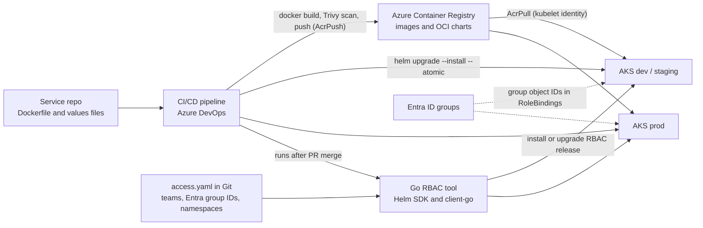

# My Projects: Docker, ACR, and Helm Standards with Go-Based RBAC Automation

> STAR template for the project where you standardised Docker builds, Azure Container Registry, and Helm deployments, and wrote a Go tool that automates Kubernetes RBAC through Helm across clusters, with an architecture sketch and likely follow-up questions.

## Key Concepts

Lines marked **From resume:** repeat a claim already on the resume. The rest is a draft answer built from the resume; check every line against what really happened, and replace each `[Confirm: …]` with the real detail.

### Situation

Guiding prompts: How did teams build images and deploy to Kubernetes before? Were Dockerfiles, tags, and charts different per team? How was access to clusters granted, and what went wrong (too much access, slow requests, drift between clusters)?

- This was at Impressico Business Solutions, where I have worked as a DevOps Engineer since January 2025.
- We had [Confirm: number of services, teams, and AKS clusters] deploying to AKS clusters across dev, staging, and prod.
- Before the standard, every team wrote its own Dockerfile and its own Helm chart. Some images used large base images and ran as root, some were tagged `latest`, and values were copied between environments by hand. The same service often had different settings in staging and prod, so a deployment that worked in one environment failed in the next.
- Access to clusters was granted by hand. An engineer ran `kubectl create rolebinding` on one cluster when a team asked, so each cluster ended up with a different set of RoleBindings, some bound to single users who had left the team. [Confirm this happened, or swap in your own] For example, a developer had edit rights in the prod namespace on one cluster but not on its pair, and nobody could say who had approved it.

### Task

Guiding prompts: What were you asked to do, or what did you take on? Who had to adopt the standard? What were the constraints?

- **From resume:** standardise Docker, ACR, and Helm usage, and automate Kubernetes RBAC with Helm across clusters using Go.
- I owned the build and deploy standard end to end: the Dockerfile rules, the ACR layout, the shared Helm chart, and the pipeline template. I designed and wrote the Go RBAC tool myself, and the rest of the platform team reviewed the code and the access config.
- Constraints: no downtime for running services, application teams had to keep shipping while they moved to the new chart, security wanted every access change to be reviewed and traceable, and the clusters already used Entra ID integration, so access had to be based on Entra ID groups and not on local accounts.

### Action

Guiding prompts: What did the standard include? What did the Go tool do, step by step? How did it reach each cluster and authenticate? How did you test changes before rollout?

- **From resume:** wrote the Helm-based Kubernetes RBAC automation in Go and ran it across clusters.
- Step 1, Docker and ACR. I wrote a Dockerfile standard: multi-stage builds, approved base images imported into our own ACR with `az acr import`, a non-root user, a `.dockerignore`, and no `latest` tag. Every image is tagged with the Git commit SHA, so a tag always points to one exact build. The pipeline builds the image, scans it with Trivy, and only pushes to ACR if the scan passes. The pipeline identity has `AcrPush` on the registry, and AKS pulls through the kubelet identity with `AcrPull`.
- Step 2, Helm. I built one shared chart for our standard workloads (Deployment, Service, HPA, probes, resource limits, security context) and pushed it to ACR as an OCI artifact with `helm push`. Each service repo only keeps a small `values.yaml` plus `values-dev.yaml`, `values-staging.yaml`, and `values-prod.yaml`. The pipeline template runs `helm upgrade --install --atomic --wait` with the right values file, so a failed release rolls back on its own.
- Step 3, the Go tool. Input is one YAML file in Git that lists each team, its Entra ID group object ID, its namespaces, and its access level (view, edit, or admin) per environment. The tool parses it with strict decoding so unknown fields fail, validates it (group IDs are GUIDs, namespaces exist in the cluster list, no admin in prod without an explicit flag), then turns it into values for an RBAC Helm chart. For each cluster it uses the Helm Go SDK (`helm.sh/helm/v3/pkg/action`) to run an install or upgrade of the RBAC release, and client-go to check namespaces and run a `SubjectAccessReview` after the apply to prove each group has the access it should. Clusters run in parallel with `errgroup`, and one failed cluster does not block the others but fails the run.
- Step 4, how it ran. The tool runs in the pipeline [Confirm: Azure DevOps Pipelines or GitHub Actions]. A pull request to the access file triggers a dry run that renders the chart and prints a diff per cluster, and the PR needs approval from the platform team under branch policies. After merge, the pipeline applies to dev, then staging, then prod behind an approval gate. A scheduled run also checks for drift.
- Trade-off: Kubernetes RBAC bound to Entra ID groups, managed by Helm, against Azure RBAC for Kubernetes authorization. Azure RBAC would let us manage access as Azure role assignments in Bicep, but we needed custom namespace-level roles, wanted the same chart to work on every cluster, and wanted a full history of each change with `helm history`. So we kept Kubernetes RBAC for in-cluster access and used Azure RBAC only for the `Azure Kubernetes Service Cluster User Role` that lets people get credentials.
- [Confirm this happened, or swap in your own] A problem I hit: on the first run, Helm refused to create bindings that already existed by hand, with the error "invalid ownership metadata". I added an adopt step to the tool that, for objects we had approved, adds the label `app.kubernetes.io/managed-by=Helm` and the annotations `meta.helm.sh/release-name` and `meta.helm.sh/release-namespace`, so Helm took ownership without deleting and recreating them. Bindings that were not in the config were reported, reviewed with the owning team, and then removed.

### Result

Guiding prompts: What measurably improved? Think about time to grant access, number of manual RoleBindings removed, onboarding time for a new service, failed deployments, and audit findings.

- Configuration drift between environments went down because every service now used the same chart and the same pipeline template, and access was the same on every cluster because it came from one file. Granting access changed from a manual request to a pull request that is applied in one pipeline run. [Confirm: time to grant access before and after]
- Adoption: [Confirm: number of services moved to the shared chart and clusters managed by the tool]. Every access change now has a PR, an approver, and a Helm revision, which made access reviews simple.
- Next time I would move both the deployments and the RBAC chart to a GitOps model, so the cluster pulls the desired state and fixes drift on its own, and I would add policy checks earlier in the PR.

### Architecture

Draft based on the resume; adjust to match the real setup.

- Service repo to pipeline to ACR: each commit builds a multi-stage image, Trivy scans it, and the pipeline identity with `AcrPush` pushes it tagged with the commit SHA.
- Pipeline to AKS: the pipeline deploys the shared chart from ACR with the environment values file; AKS pulls the image through the kubelet identity with `AcrPull`.
- Access config to Go tool to AKS: a merged change to `access.yaml` makes the pipeline run the Go tool, which installs or upgrades the RBAC Helm release on each cluster.
- Entra ID to AKS: RoleBindings point to Entra ID group object IDs, so users get access through group membership and log in with kubelogin.

### Tech stack

- **From resume:** Docker, Azure Container Registry, Helm, Kubernetes RBAC, Go, AKS.
- Go libraries: the Helm Go SDK (`helm.sh/helm/v3/pkg/action`, `chart/loader`) to render and apply the chart, client-go for namespace checks and `SubjectAccessReview`, `golang.org/x/sync/errgroup` for parallel clusters, and a YAML library with strict decoding for the config.
- CI/CD: Azure DevOps Pipelines built the images, deployed the charts, and ran the Go tool.
- Authentication: a pipeline service connection using workload identity federation, `az aks get-credentials` per cluster, and `kubelogin convert-kubeconfig -l azurecli` so the tool uses an Entra ID token. Local accounts are disabled on the clusters.

## Interview Questions

Q1. [Basic] Give me a two-minute overview of this project.

**Answer:**

At Impressico I worked on two connected problems on our AKS platform. The first was how services were built and deployed. Every team had its own Dockerfile and Helm chart, images were sometimes tagged <code>latest</code>, and values were copied by hand between environments, so we had a lot of configuration drift. The second was access. People got cluster access by someone running <code>kubectl create rolebinding</code> by hand, so every cluster had different bindings and nobody could audit them.

For the build side, I wrote a standard: multi-stage Dockerfiles on approved base images in our ACR, non-root users, images tagged with the Git commit SHA, a Trivy scan before push, and one shared Helm chart stored in ACR as an OCI artifact. Each service only keeps its values files per environment, and one pipeline template runs <code>helm upgrade --install --atomic</code>.

For access, I wrote a Go tool. It reads one YAML file in Git that maps Entra ID groups to namespaces and roles, validates it, and uses the Helm Go SDK to install an RBAC chart on every cluster in parallel, then checks the result with a SubjectAccessReview through client-go. Changes go through a pull request with a dry-run diff, then roll out dev, staging, prod.

The result was less drift between environments, the same access on every cluster, and every access change reviewed and traceable in Git and Helm history.

**Hints:** split the story clearly into the build and deploy standard and the RBAC automation; spend most of the time on what you did.

Q2. [Intermediate] What did "standardising Docker, ACR, and Helm" mean in practice?

**Answer:**

It meant a small set of rules plus shared files, so teams did not have to invent their own. For Docker: multi-stage builds, only approved base images that we imported into our own ACR with <code>az acr import</code>, a non-root user, a <code>.dockerignore</code>, and no <code>latest</code> tag. Every image is tagged with the Git commit SHA, so a tag is immutable and I can always trace a running pod back to a commit. For ACR: one registry layout, images under a repository per service, and the shared chart pushed as an OCI artifact with <code>helm push oci://&lt;registry&gt;.azurecr.io/helm</code>. For Helm: one shared chart with the Deployment, Service, HPA, probes, resource limits, and security context, and each service keeps only <code>values.yaml</code> plus <code>values-dev.yaml</code>, <code>values-staging.yaml</code>, and <code>values-prod.yaml</code>. Finally, one pipeline template: build, Trivy scan, push, then <code>helm upgrade --install --atomic --wait</code> per environment. A new service could plug into it with a few lines of YAML.

**Hints:** a strong answer names specifics, such as approved base images, immutable image tags (for example the Git commit SHA), a shared chart with per-environment values files, and one pipeline template.

Q3. [Intermediate] How did AKS pull images from ACR, and how did pipelines push to it?

**Answer:**

For pull, we attached the registry to each cluster with <code>az aks update -n &lt;cluster&gt; -g &lt;rg&gt; --attach-acr &lt;acr&gt;</code>. That gives the cluster's kubelet managed identity the <code>AcrPull</code> role on the registry, so nodes pull images without any image pull secret in the namespaces. For new clusters we did the same role assignment in Bicep so it was in code. For push, the pipeline uses a service connection based on workload identity federation, so there is no stored secret. That identity has only <code>AcrPush</code> on the registry, not Contributor. The pipeline runs <code>az acr login</code> and then <code>docker push</code>, or for the chart <code>helm push</code>. The ACR admin user stays disabled, because it is one shared username and password with full rights and no audit of who used it. We also kept the registry on a private endpoint with Private DNS, so pulls from AKS stayed inside the VNet.

**Hints:** mention that attaching ACR to AKS gives the kubelet identity the <code>AcrPull</code> role, that pipelines push with an identity holding <code>AcrPush</code>, and that the ACR admin user should stay disabled.

Q4. [Intermediate] Why did you write the RBAC automation in Go instead of Bash or plain Helm commands?

**Answer:**

I started with the obvious option, a Bash script looping over clusters and calling <code>helm upgrade</code>. It worked for two clusters, but error handling was weak, the config was untyped so a typo in a group ID only showed up after the apply, and it ran one cluster at a time. Go fixed those. The config is parsed into structs with strict decoding, so unknown fields and bad GUIDs fail before anything touches a cluster. The Helm Go SDK and client-go are the same libraries Helm and kubectl use, so I could install the release, then run a SubjectAccessReview in the same program and return a clear error per cluster. With goroutines and <code>errgroup</code> the clusters run in parallel. And it ships as one static binary, so the pipeline agent needs no extra runtime. The cost is that the team needs Go skills to change it. I kept the code small, wrote tests for the config validation, and documented it, and most changes are to the YAML file, not the code.

**Hints:** a strong answer covers trade-offs: a single binary, typed config, better error handling, and running across many clusters in parallel, against the cost of the team needing Go skills to maintain it.

Q5. [Intermediate] Which RBAC objects did the chart create, and how were they mapped to people?

**Answer:**

Most access was namespace-scoped. For each team and namespace the chart created a RoleBinding that points to one of the built-in ClusterRoles, <code>view</code>, <code>edit</code>, or <code>admin</code>, so the rights are defined once and applied per namespace. Where a team needed something narrower, for example read pods and logs plus exec in dev only, the chart created a namespace Role with exactly those verbs and resources. Cluster-wide access was rare: a ClusterRoleBinding to <code>view</code> for the platform and support groups, and <code>cluster-admin</code> only for a small platform admin group. Because the clusters use Entra ID integration, every subject was an Entra ID group, with <code>kind: Group</code> and the group's object ID as the name, never a single user. So adding or removing a person is a change in Entra ID group membership, and the chart only changes when a team or namespace changes. In prod, teams got <code>view</code> by default, because deployments go through the pipeline, not people.

**Hints:** cover namespace-scoped Role and RoleBinding vs cluster-wide ClusterRole and ClusterRoleBinding, and binding to Entra ID group object IDs instead of single users when AKS uses Entra ID integration.

Q6. [Advanced] How did the tool authenticate to many clusters safely?

**Answer:**

The tool never held long-lived secrets. In the pipeline it runs under a service connection that uses workload identity federation, so Azure issues a short-lived token. For each cluster the pipeline runs <code>az aks get-credentials -g &lt;rg&gt; -n &lt;cluster&gt;</code> without <code>--admin</code>, then <code>kubelogin convert-kubeconfig -l azurecli</code>, so the kubeconfig gets an Entra ID token from the logged-in identity instead of a static client certificate. The kubeconfig is written to the agent's temp folder and removed at the end of the job. Local accounts are disabled with <code>az aks update --disable-local-accounts</code>, so nobody can fall back to the admin certificate. The pipeline identity has only the <code>Azure Kubernetes Service Cluster User Role</code> in Azure, and inside the cluster it is bound to a ClusterRole that covers RBAC objects, namespaces, and the Helm release secrets. Creating bindings needs the <code>bind</code> verb, which is powerful, so that identity is used only by this pipeline and changes need PR approval.

**Hints:** mention getting kubeconfig with <code>az aks get-credentials</code> and kubelogin for Entra ID clusters, a pipeline identity using workload identity federation or a managed identity, disabled local accounts, and least privilege for the tool itself.

Q7. [Advanced] After an RBAC rollout, a team says they lost access. How do you find and fix the cause? <em>(scenario)</em>

**Answer:**

[Confirm this happened, or swap in your own] The common case is a wrong or changed group object ID, or a namespace renamed in the config. First I confirm what the team sees: their exact error and namespace. Then I test the permission directly with <code>kubectl auth can-i list pods -n &lt;ns&gt; --as=&lt;user&gt; --as-group=&lt;group-object-id&gt;</code>. If that says no, I check the RoleBinding with <code>kubectl get rolebinding -n &lt;ns&gt; -o yaml</code> and compare the subject with the group in Entra ID using <code>az ad group show</code>. If the binding is wrong, the quickest fix is <code>helm history</code> on the RBAC release and <code>helm rollback &lt;release&gt; &lt;revision&gt;</code> to the last good revision, which restores access in seconds. Then I fix the config in Git through a PR. To stop it happening again, the PR now runs the tool in dry-run mode and shows which subjects lose access per cluster, and the tool validates that every group ID exists in Entra ID before applying.

**Hints:** a strong answer uses <code>kubectl auth can-i --as</code> to test, <code>helm history</code> and <code>helm rollback</code> to recover fast, and then adds a check (for example a dry run or diff in the pipeline) so it does not happen again.

Q8. [Advanced] How did you stop people from creating RoleBindings by hand and causing drift?

**Answer:**

Three layers. First, prevention through permissions: teams get the built-in <code>edit</code> ClusterRole at most, which does not include Roles or RoleBindings, and only the platform admin group and the pipeline identity can create bindings. Second, Helm owns every approved object, so if someone changes one by hand, the next run puts it back. Third, detection: a scheduled pipeline run uses client-go to list all RoleBindings and ClusterRoleBindings and reports any that are not labelled <code>app.kubernetes.io/managed-by=Helm</code> or are not in the config, and the dry-run diff shows changes to managed ones. Drift findings go to the platform channel, and we either add the binding to the config through a PR or delete it. I would also consider an Azure Policy for AKS rule to block bindings created outside the pipeline identity, but the permission model and the scheduled check covered most of it.

**Hints:** mention that Helm owns the objects, a regular diff or reconcile run, limiting who can create bindings, and policy tools such as Azure Policy for AKS if you used them.

Q9. [Advanced] If you did this project again, what would you change?

**Answer:**

The main thing is that the tool is push-based. It only fixes drift when the pipeline runs, and the pipeline identity needs strong rights on every cluster. If I did it again I would use GitOps, with the Flux extension for AKS or Argo CD, so each cluster pulls the RBAC chart and the app charts from Git and reconciles on its own. The Go code would then shrink to a validator and generator that runs in the PR, which is where most of its value was anyway. Second, I would look again at Azure RBAC for Kubernetes authorization for the simple view and edit cases, because those role assignments could live in our Bicep code with the rest of our IAM. What I learned is that most of the value came from having one reviewed source of truth for access, more than from the tool itself.

**Hints:** pick a real limitation, for example GitOps instead of a push-based tool, and say what you learned.

See also: [Helm security and CI/CD](../helm/04-security-cicd-and-troubleshooting.md), [Kubernetes RBAC and secrets](../kubernetes/06-security-rbac-secrets.md), and [Docker security and CI/CD](../docker/05-security-ci-cd-and-deployments.md).
