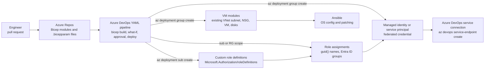

# My Projects: Least-Privilege Azure RBAC and Provisioning with Bicep

> STAR template for the project where you built reusable Bicep modules for custom roles and RBAC assignments to replace broad Owner and Contributor grants, and automated Azure DevOps service connections and VM provisioning with Bicep, with an architecture sketch and likely follow-up questions.

## Key Concepts

Lines marked **From resume:** repeat a claim already on the resume. The rest is a draft answer built from the resume; check every line against what really happened, and replace each `[Confirm: …]` with the real detail.

### Situation

Guiding prompts: Who had Owner or Contributor, and at which scope? Why was that a risk (audit finding, incident, compliance)? How were service connections and VMs created before, and how long did a new environment take?

- This was at Infosys, where I worked as a Technology Analyst from March 2021 to December 2024. The client ran healthcare microservices and supporting VMs on Azure. I later used the same custom-role approach at Impressico from January 2025.
- Before this work, access was granted by hand in the portal. Application teams and pipeline service principals often had Contributor, and some had Owner, at subscription scope [Confirm: number of subscriptions and teams in scope]. A typical example: a team that only needed to restart VMs and read logs had Contributor on the whole subscription, so it could also delete storage accounts or change NSGs in other teams' resource groups.
- Service connections in Azure DevOps were created by hand. Someone created an app registration, generated a client secret, gave it Contributor, and pasted the values into Azure DevOps. VMs were also built in the portal or with one-off scripts, so each new environment needed tickets, hand-offs and waiting between teams.
- It mattered for three reasons. Broad grants are a security and compliance risk for a healthcare workload, nobody could easily answer "who has access to what and why", and onboarding a new team or environment was slow and inconsistent.

### Task

Guiding prompts: What were you asked to do, or what did you take on? Which subscriptions and teams were in scope? What were the constraints?

- **From resume:** replace broad Owner and Contributor grants with least-privilege access using reusable Bicep modules for custom role definitions and RBAC assignments at subscription and resource group scope.
- **From resume:** automate Azure DevOps service connections and VM provisioning with Bicep.
- I owned the Bicep modules, the deployment pipeline and the rollout plan. Approval of the role designs and the final removal of Owner grants sat with the client's security and platform leads. The constraints were: no downtime for running pipelines, no loss of access for on-call engineers during incidents, and every change had to go through a reviewed pull request.

### Action

Guiding prompts: How were the modules structured? How did you decide which permissions each role needed? How did you roll out the change without breaking pipelines or people? Which part of the service connection work did Bicep do, and which part used the Azure DevOps CLI or REST API?

- **From resume:** built reusable Bicep modules for custom role definitions and role assignments at subscription and resource group scope.
- Step 1, finding real usage. I exported role assignments with `az role assignment list --all --include-inherited -o table` to see who had what. Then I queried the Azure Activity Log in Log Analytics (the `AzureActivity` table, grouped by `Caller` and `OperationNameValue`) for each team and each pipeline identity over a few weeks. That showed which write and action operations they actually used, which was always far less than Contributor.
- Step 2, module design. I wrote small modules in a Git repo in Azure Repos: `roleDefinition.bicep` (`targetScope = 'subscription'`, creates `Microsoft.Authorization/roleDefinitions`), `roleAssignment-sub.bicep` and `roleAssignment-rg.bicep` (create `Microsoft.Authorization/roleAssignments` at that scope). Inputs were the role name, `actions`, `notActions`, `dataActions`, `assignableScopes`, the principal ID and the principal type. Role and assignment names were built with `guid()` from stable inputs so redeploys were idempotent. Each team had a `.bicepparam` file that listed its Entra ID groups and roles, so onboarding a team was a pull request that added one parameter file. Modules were versioned with Git tags.
- Step 3, service connections. Bicep created the Azure side: a user-assigned managed identity (or a service principal for older connections), a federated identity credential on it, and a narrow role assignment on the target resource group. The Azure DevOps side was created with `az devops service-endpoint create --service-endpoint-configuration sc.json`, because a service connection is an Azure DevOps object, not an Azure resource. Where we still used secrets, the secret was kept in Key Vault and rotated, never stored in the repo [Confirm: whether connections used workload identity federation, secrets, or both].
- Step 4, VM provisioning. I built reusable VM modules for Linux and Windows that standardized the image, disk type, availability zone, boot diagnostics, NIC and NSG, and took the subnet ID of an existing VNet as a parameter. An Azure DevOps YAML pipeline ran build, `what-if`, a manual approval for production, and then `az deployment group create`. Post-deployment configuration was done with Ansible.
- Rollout. I piloted with one team first. I assigned the new custom role next to the existing Contributor grant, watched the activity log and pipeline runs for a couple of weeks, fixed any missing actions, and only then removed Contributor through a pull request. The rollback plan was simple: re-run the previous tagged version of the parameter file, which restored the old assignment in minutes. I announced each change to the team in advance and documented the role and its reason in the repo.
- [Confirm this happened, or swap in your own] Trade-off: I chose a few custom roles per team type instead of one role per person or per pipeline. That is slightly broader than perfect least privilege, but much easier to review and keeps us far below the custom role limit per tenant. Problem: after removing Contributor, a VM pipeline failed with `AuthorizationFailed` on `Microsoft.Network/virtualNetworks/subnets/join/action`, because the VNet lived in a separate network resource group. I added only that action, scoped to the network resource group, and the pipeline passed.

### Result

Guiding prompts: What measurably improved? Think about provisioning time, number of Owner and Contributor grants removed, audit findings, and time to onboard a new team or environment.

- **From resume:** environment provisioning more than 70% faster with Bicep.
- How the 70% was measured: "before" was the elapsed time from the request ticket to a usable environment (resource group, VMs, storage and service connection ready), taken from ticket timestamps. "After" was the same, using the Azure DevOps pipeline run history plus the approval wait. I compared the average over several environments of the same type [Confirm: before and after times, and which environment type].
- Broad Owner and Contributor grants at subscription scope were replaced by custom roles assigned through code, and every remaining assignment had an owner and a reason in the repo [Confirm: number of broad grants removed or replaced].
- Next time I would add Entra ID PIM for rare elevated access from day one, and add an automated weekly drift report that compares live role assignments against the repo.

### Architecture

Draft based on the resume; adjust to match the real setup.



- Engineer to Azure Repos to pipeline: every access or VM change is a reviewed pull request; the pipeline builds the Bicep, runs `what-if`, waits for approval in production, then deploys.
- Pipeline to role definitions and assignments: custom roles are created at subscription scope, then assigned to Entra ID groups or identities at subscription or resource group scope.
- Pipeline to identity to service connection: Bicep creates the identity, its federated credential and its narrow role assignment; the Azure DevOps CLI creates the service connection that uses it.
- Pipeline to VM to Ansible: the VM module deploys into an existing subnet with a standard NSG and disks, and Ansible configures the OS afterwards.

### Tech stack

- **From resume:** Bicep, Azure RBAC, custom role definitions, Azure DevOps service connections, Azure VMs.
- Modules were shared as a Git repo in Azure Repos, versioned with tags, and referenced by relative path from each environment's parameter files. A Bicep registry in ACR or template specs would be the next step for wider sharing.
- Service connection auth: workload identity federation for new connections, so there is no client secret; older secret-based connections kept their secret in Key Vault until migrated.
- Pipeline: Azure DevOps YAML with `az bicep build` (the linter runs as part of the build, configured in `bicepconfig.json`), `az deployment sub what-if` or `az deployment group what-if`, a manual approval check on the production environment, then the deploy step.

## Interview Questions

<details><summary>Q1. [Basic] Give me a two-minute overview of this project.</summary>

**Answer:**

At Infosys I worked on an Azure estate for a healthcare client. Access was granted by hand in the portal, and many teams and pipeline service principals had Contributor or even Owner at subscription scope. That meant one team could delete or change another team's resources, and nobody could easily say who had access to what and why. Service connections and VMs were also built by hand, so every new environment needed tickets and waiting.

My task was to replace those broad grants with least-privilege access defined in code, and to automate service connections and VM provisioning.

I first exported all role assignments and used the Activity Log in Log Analytics to see which operations each team and pipeline really used. Then I built reusable Bicep modules: one for custom role definitions at subscription scope, and two for role assignments at subscription and resource group scope, with <code>guid()</code> names so redeploys are idempotent. Each team had a parameter file, so access changes became pull requests. Bicep also created the identities and role assignments behind Azure DevOps service connections, and reusable VM modules standardized image, disks, zones and NSGs. An Azure DevOps pipeline ran <code>what-if</code>, an approval, and the deploy.

I rolled out one pilot team first, running the new role beside Contributor before removing it.

The result was access that is reviewable, repeatable and auditable, and environment provisioning more than 70% faster. I measured that by comparing ticket-to-ready time before with pipeline run time plus approval after, averaged over the same type of environment.

**Hints:** lead with the security problem, then the Bicep modules, then the more than 70% faster provisioning and how it was measured.

</details>

<details><summary>Q2. [Intermediate] How do you define a custom role in Bicep, and what does <code>assignableScopes</code> do?</summary>

**Answer:**

Custom roles are subscription-level (or management group) objects, so my module used <code>targetScope = 'subscription'</code> and the <code>Microsoft.Authorization/roleDefinitions</code> resource. A short sketch:

```bicep
targetScope = 'subscription'
param roleName string
param actions array
param notActions array = []
param dataActions array = []
param assignableScopes array = [ subscription().id ]

resource role 'Microsoft.Authorization/roleDefinitions@2022-04-01' = {
  name: guid(subscription().id, roleName)
  properties: {
    roleName: roleName
    type: 'CustomRole'
    permissions: [ { actions: actions, notActions: notActions, dataActions: dataActions, notDataActions: [] } ]
    assignableScopes: assignableScopes
  }
}
output roleDefinitionId string = role.id
```

<code>actions</code> are control-plane operations such as <code>Microsoft.Compute/virtualMachines/restart/action</code>. <code>notActions</code> subtracts from them; it is not a deny. <code>dataActions</code> cover data-plane operations, for example reading blobs. <code>assignableScopes</code> limits where the role can be assigned. If it lists only one subscription or one resource group, nobody can assign that role anywhere else.

**Hints:** a strong answer covers <code>targetScope = 'subscription'</code>, the <code>Microsoft.Authorization/roleDefinitions</code> resource, <code>actions</code>, <code>notActions</code>, and <code>dataActions</code>, and that <code>assignableScopes</code> limits where the role can be assigned.

</details>

<details><summary>Q3. [Intermediate] Why should a role assignment name be built with <code>guid()</code> in Bicep?</summary>

**Answer:**

The name of a role assignment must be a GUID, so I can't use a friendly name. If you generate a random GUID, every deployment tries to create a new assignment, and Azure rejects it with "role assignment already exists", because the same principal, role and scope already has one. In my module I built the name from stable inputs:

```bicep
resource ra 'Microsoft.Authorization/roleAssignments@2022-04-01' = {
  name: guid(resourceGroup().id, principalId, roleDefinitionId)
  properties: {
    roleDefinitionId: roleDefinitionId
    principalId: principalId
    principalType: principalType // 'Group' or 'ServicePrincipal'
  }
}
```

The same inputs always give the same GUID, so a redeploy updates the same assignment instead of failing. That is what makes the pipeline idempotent. I also set <code>principalType</code>, which helps avoid errors when a new identity has not finished replicating in Entra ID.

**Hints:** the name must be a GUID, and building it from stable inputs (scope, principal ID, role ID) makes redeployments idempotent instead of failing with a "role assignment already exists" error.

</details>

<details><summary>Q4. [Intermediate] How did you decide what permissions a team or pipeline needed instead of Contributor?</summary>

**Answer:**

I started from what was actually used, not from what people asked for. I queried the <code>AzureActivity</code> table in Log Analytics for each team's group members and each pipeline identity, and listed the distinct operation names over a few weeks. Then I checked whether a built-in role already fit, for example Virtual Machine Contributor or Storage Blob Data Reader. If it did, I used it, because Microsoft maintains it. Only when nothing fit did I write a custom role.

One example: an operations team had Contributor on the subscription, but they only started, stopped and restarted VMs and read monitoring data. I gave them a custom role with <code>Microsoft.Compute/virtualMachines/read</code>, <code>start/action</code>, <code>restart/action</code> and <code>deallocate/action</code>, plus Monitoring Reader, scoped to their resource groups. [Confirm this happened, or swap in your own]

I scoped to resource groups wherever possible, and failed deployments after the change told me about any action I had missed. Roles were reviewed in the repo on a regular schedule.

**Hints:** mention starting from what was actually used (activity logs, failed deployments), preferring built-in roles when they fit, scoping to a resource group, and reviewing roles regularly.

</details>

<details><summary>Q5. [Intermediate] How did you automate Azure DevOps service connections?</summary>

**Answer:**

The key point is the boundary. Bicep only deploys Azure resources. A service connection is an object inside Azure DevOps, so Bicep cannot create it directly.

On the Azure side, Bicep created a user-assigned managed identity, a <code>federatedIdentityCredentials</code> child resource on it, and a role assignment for that identity on only the resource group the pipeline deploys to. The federated credential uses the issuer and subject that Azure DevOps gives for the connection, in the form <code>sc://org/project/connection-name</code>.

On the Azure DevOps side, the pipeline ran <code>az devops service-endpoint create --service-endpoint-configuration sc.json</code>, with a JSON file that sets the authorization scheme to workload identity federation and passes the client ID, tenant ID and subscription. The REST API works the same way.

With workload identity federation there is no client secret to store, leak or rotate; Azure DevOps gets a short-lived token at run time. For older secret-based connections, the secret lived in Key Vault until we migrated them.

**Hints:** be clear about the boundary: Bicep creates Azure-side resources such as identities and role assignments, while the service connection itself lives in Azure DevOps. Workload identity federation avoids storing a client secret.

</details>

<details><summary>Q6. [Intermediate] How did Bicep make environment provisioning more than 70% faster, and how did you measure it?</summary>

**Answer:**

Before, a new environment was a chain of manual steps: a ticket to create the resource group, someone clicking through the portal for VMs and storage, another ticket for the app registration and service connection, and a third for access. Most of the time was waiting between teams, not the work itself.

After, one pull request added a parameter file. The pipeline ran <code>what-if</code>, waited for one approval, and deployed the resource group, VMs, storage, identity, role assignments and service connection together. Ansible then configured the OS.

To measure it, I took the "before" time from ticket timestamps, request opened to environment ready, and the "after" time from the Azure DevOps pipeline run history plus the approval wait. I averaged over several environments of the same type, so I was comparing like with like. The result was more than 70% faster [Confirm: before and after times]. It is an average from those records, not a lab benchmark, and I would say so in an interview.

**Hints:** give the real before and after durations, what was manual before (portal clicks, tickets, waiting), and say clearly if the number is an estimate.

</details>

<details><summary>Q7. [Advanced] After you removed Contributor, a pipeline fails with <code>AuthorizationFailed</code>. What do you do? <em>(scenario)</em></summary>

**Answer:**

First I read the error carefully. It names the client ID, the exact action and the scope, for example "does not have authorization to perform action <code>Microsoft.Network/virtualNetworks/subnets/join/action</code> over scope ...". That tells me exactly what is missing.

Then I check if the scope is the one I expected. [Confirm this happened, or swap in your own] In a real case during rollout, the VM pipeline had rights on the application resource group, but the VNet lived in a separate network resource group. The fix was not to give Contributor back, but to add only the subnet join action, assigned on the network resource group.

I made that change through a pull request to the role module, ran <code>what-if</code> and deployed. I also remember that role changes can take a few minutes to apply, so I wait and re-run instead of assuming the fix did not work. If an urgent production release is blocked, the rollback is redeploying the previous tagged parameter file, then fixing forward.

**Hints:** read the exact action and scope in the error, add only that action to the custom role or assign a narrow built-in role, and remember that role changes can take a few minutes to apply.

</details>

<details><summary>Q8. [Advanced] How did you get teams to accept losing Owner and Contributor access?</summary>

**Answer:**

The main pushback came from senior engineers and pipeline owners who were afraid of being blocked during an incident.

I explained the risk in their terms: with Contributor on the subscription, one wrong script or a leaked secret could delete another team's production resources, and for a healthcare client that is also an audit problem. I showed them their own activity log data, so they could see the new role covered what they actually did.

I piloted with one team, running the new role next to Contributor for a couple of weeks before removing anything, and fixed gaps quickly. I gave a fast path for more access: a pull request to the role repo, reviewed the same day. For rare elevated tasks, a just-in-time option such as Entra ID PIM is the right answer, and I would make that standard from the start. Every decision and each role's purpose was documented in the repo.

**Hints:** show influence: explain the risk in their terms, pilot with one team, give a fast path for extra access (for example a just-in-time option such as Entra ID PIM, if you used it), and document the decision.

</details>

<details><summary>Q9. [Advanced] How did you test and release changes to the shared Bicep modules safely?</summary>

**Answer:**

Every change went through a pull request with a branch policy, so at least one reviewer approved it. The PR pipeline ran <code>az bicep build</code>, which also runs the Bicep linter with rules set in <code>bicepconfig.json</code>, so issues like hardcoded locations or unused parameters failed the build.

Then it ran <code>az deployment sub what-if</code> for role definitions and <code>az deployment group what-if</code> for resource group deployments against a lower, non-production subscription. What-if shows exactly which roles and assignments will be created, changed or deleted, which matters a lot when a mistake can remove someone's access.

After merge, the module got a new Git tag. Environments referenced a specific version, so a change rolled out to dev and test first, and production only moved to the new version after it had run cleanly there and passed a manual approval on the production environment.

**Hints:** mention the Bicep linter, <code>az deployment sub what-if</code> or <code>az deployment group what-if</code> in the pipeline, versioned modules, and testing in a lower subscription first.

</details>

<details><summary>Q10. [Advanced] If you did this project again, what would you change?</summary>

**Answer:**

Two things. First, I would add just-in-time elevation with Entra ID PIM from the start. We removed standing Owner access, but the path for rare, legitimate elevated tasks was a pull request, which is slow during an incident. PIM gives time-limited, approved and logged elevation.

Second, I would add automated drift detection for RBAC. Someone with enough rights could still add an assignment in the portal, and it would not show up in the repo until somebody looked. A scheduled pipeline that compares <code>az role assignment list</code> output with the repo, plus an Azure Policy audit, would catch that within a day.

I would also publish the modules to a Bicep registry in ACR instead of sharing them by Git path, so other teams can consume versioned modules more easily. The lesson for me was that the code was the easy part; the rollout plan and keeping access and code in sync over time mattered more.

**Hints:** pick a real limitation and say what you learned; avoid "nothing".

</details>

See also: [Bicep scopes and environments](../bicep/02-deployment-scopes-environments-and-secrets.md), [Azure identity and governance](../azure/05-identity-security-and-governance.md), and [Azure DevOps security and secrets](../azure-devops/05-security-and-secrets.md).
