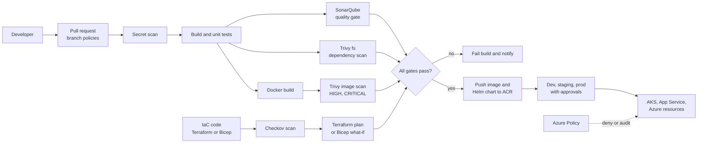

# My Projects: CI/CD Pipelines with DevSecOps Quality Gates

> STAR template for the project where you built CI/CD across Azure DevOps, GitHub Actions, GitLab CI, and Jenkins with SonarQube, Trivy, and Checkov quality gates, secret scanning, Azure Policy, and branch policies, with an architecture sketch and likely follow-up questions.

## Key Concepts

Lines marked **From resume:** repeat a claim already on the resume. The rest is a draft answer built from the resume; check every line against what really happened, and replace each `[Confirm: …]` with the real detail.

### Situation

Guiding prompts: How were builds and releases done before? Why were there four CI/CD tools? What went wrong: slow releases, failed deployments, vulnerabilities found late, secrets in code?

- This project was at Impressico Business Solutions, from January 2025 to now. The Jenkins Declarative Pipelines and Azure DevOps Classic Release pipelines came earlier, at Infosys (March 2021 to December 2024). That is where I learned the stage, approval and rollback pattern I reused here.
- At Impressico, code lived in three places: Azure Repos, GitHub and GitLab. Each team built in the CI tool next to its repo, so we ran Azure DevOps Pipelines, GitHub Actions and GitLab CI side by side. In total it was [Confirm: number of repos and pipelines], and [Confirm: which teams or products used which tool].
- Before this work, every team wrote its own pipeline. Stages were not the same, security scans were missing or only advisory, and some releases still had manual steps. We found vulnerable base images and misconfigured IaC (for example storage accounts with public access) only after deployment, during reviews or audits.
- It mattered for two reasons. Releases were slow because changes waited for manual checks and rework. Security and compliance findings showed up late, when they were expensive to fix and could reach production.

### Task

Guiding prompts: What were you asked to do, or what did you take on? Who had to adopt the new gates? What were the constraints?

- **From resume:** build and run CI/CD pipelines across Azure DevOps, GitHub Actions, GitLab CI, and Jenkins with security and quality gates.
- I owned the pipeline design: the shared templates, the scanner stages, the gate thresholds and the branch policies. Application teams owned their build and test steps, and they had to adopt the templates. I worked in a team of [Confirm: DevOps team size].
- The constraints: we could not stop delivery while rolling out the gates, we could not force one CI tool on every team, and the scans had to keep pipeline time acceptable. Stakeholders were the developers, the security team (who set the severity policy), and the release managers who approved production.

### Action

Guiding prompts: What stages did a standard pipeline have? Where did each gate run and what failed the build? How did you keep four tools consistent? How did you handle false positives and pushback from developers?

- **From resume:** added SonarQube, Trivy, and Checkov quality gates, secret scanning, Azure Policy, and branch policies.
- Step 1: I defined one standard flow: checkout, secret scan, build and unit tests, SonarQube analysis and quality gate, Trivy dependency scan, Docker build, Trivy image scan, push to ACR, then deploy to dev, staging and prod with approvals. IaC repos had their own flow: fmt and validate, Checkov, Terraform plan or Bicep what-if, approval, apply. I shared it as an Azure DevOps <code>extends</code> template in a central templates repo, a GitHub reusable workflow (<code>workflow_call</code>), and a GitLab <code>include: project:</code> file, all pinned to a tag. The scanner commands themselves lived in shared Shell scripts and pinned container images, so the logic was the same in every tool.
- Step 2: the thresholds. SonarQube used a quality gate on new code (no new bugs or vulnerabilities, security hotspots reviewed, coverage and duplication limits), with <code>sonar.qualitygate.wait=true</code> so a failed gate fails the pipeline. Trivy ran with <code>--severity HIGH,CRITICAL --exit-code 1 --ignore-unfixed</code>. Checkov failed on any failed check that did not have a documented skip. A secret finding always failed the build.
- Step 3: in Azure Repos I set branch policies on <code>main</code> and release branches: minimum two reviewers, build validation, comment resolution, linked work items, and no direct pushes. GitHub used rulesets and GitLab used protected branches with the same rules. For Azure Policy, I assigned built-in policies at subscription scope with Bicep, for example allowed locations, no public network access on storage, and the AKS policies that block privileged containers and images from outside our ACR.
- Step 4: I rolled the gates out in warning mode first (<code>--exit-code 0</code> for Trivy, <code>--soft-fail</code> for Checkov, SonarQube gate not yet blocking) for about [Confirm: length of warning period]. Teams used that time to clear their backlog, and then I switched each gate to blocking.
- Trade-off and problem: [Confirm this happened, or swap in your own] the scans added several minutes to every run, and developers complained. I ran the scanners in parallel jobs, cached the Trivy vulnerability DB, and ran full image scans only on main and release builds, with a lighter dependency scan on pull requests. The trade-off was slightly less coverage on PRs in return for faster feedback.

### Result

Guiding prompts: What measurably improved? Think about lead time, failed deployments, vulnerabilities caught before production, and time developers spent waiting.

- **From resume:** about 50% faster release lead time.
- **From resume:** about 40% fewer failed deployments.
- Lead time is measured the DORA way: from commit (or PR merge) to a successful production deployment, using the timestamps in pipeline run history from Azure DevOps, GitHub Actions and GitLab CI. Failed deployments are counted as production deployments that failed, were rolled back or needed a hotfix, using the same run history plus incident records. The 40% figure is under Key Achievements on the resume, not tied to an employer [Confirm: which employer/project the 40% belongs to]. [Confirm: data source and before/after periods for both numbers]
- Next time I would start with one shared scanner container image from day one, and I would add dashboards for gate results earlier, so trends (open findings, exceptions, pipeline time) are visible without exporting run history.

### Architecture

Draft based on the resume; adjust to match the real setup.

- Developer to pull request: no direct pushes; the PR must pass reviewers and the build validation pipeline before merge.
- Secret scan runs first, so a leaked credential stops the run before anything is built or pushed.
- Build fans out to SonarQube, the Trivy dependency scan and the Docker build; the image is then scanned by Trivy.
- IaC goes through Checkov before plan or what-if, so bad config is caught before anything touches Azure.
- Only when every gate passes is the image pushed to ACR and promoted through environments with approvals.
- Azure Policy sits on the platform side and denies or audits non-compliant resources, whatever path created them.

### Tech stack

- **From resume:** Azure DevOps, GitHub Actions, GitLab CI, Jenkins, SonarQube, Trivy, Checkov, Azure Policy.
- Secret scanning: Trivy's secret scanner (<code>--scanners vuln,secret</code>) in every tool, plus the platform's own feature where available, such as GitHub secret scanning push protection and the GitLab Secret Detection template [Confirm: secret scanning tool actually used].
- Azure auth: Azure DevOps service connections with workload identity federation, OIDC federated credentials for GitHub Actions and GitLab CI, each identity with least-privilege RBAC. At Infosys, Jenkins used managed identities on agent VMs or service principals stored in Jenkins credentials.
- Artifacts: Docker images and Helm charts in ACR, packages in Azure Artifacts. At Infosys I also used Nexus.

## Interview Questions

Q1. [Basic] Give me a two-minute overview of this project.

**Answer:**

At Impressico, from 2025, I standardised CI/CD across Azure DevOps, GitHub Actions and GitLab CI. Each team had its own pipelines, security scans were missing or advisory, and we found vulnerable images and bad IaC only after deployment. My task was to build one standard pipeline with security and quality gates, without stopping delivery.

I built shared templates in each tool: an <code>extends</code> template in Azure DevOps, reusable workflows in GitHub and an included file in GitLab. They all called the same scanner scripts. The gates run in this order. First a secret scan, so leaked credentials stop the run. Then build and unit tests, and the SonarQube quality gate on new code. Then a Trivy dependency scan, the Docker build, and a Trivy image scan that fails on HIGH and CRITICAL findings that have a fix. For infrastructure code, Checkov runs before Terraform plan or Bicep what-if. Only when everything passes is the image pushed to ACR and promoted through dev, staging and prod with approvals. Branch policies force reviewed PRs with build validation. Azure Policy denies non-compliant resources on the platform side.

I rolled the gates out in warning mode first, then made them blocking. The result was about 50% shorter release lead time, measured from commit to production deployment in pipeline run history. The resume also lists about 40% fewer deployment failures, counted as production deployments that failed or were rolled back, before and after. [Confirm: measurement periods]

**Hints:** name the gates in pipeline order, then give the 50% lead time and 40% failed deployment numbers with how you measured them.

Q2. [Intermediate] Why four CI/CD tools, and how did you keep the pipelines consistent across them?

**Answer:**

Honestly, it was history, not a design choice. At Infosys I worked with Jenkins Declarative Pipelines and Azure DevOps YAML and Classic Release pipelines. At Impressico, code lived in Azure Repos, GitHub and GitLab, and teams used the CI tool next to their repo. Migrating everyone to one tool would have stopped delivery, so I standardised the pipeline instead of the tool.

Consistency came from reuse. The scanner logic was in shared Shell scripts and pinned container images for Trivy, Checkov and the Sonar scanner, so the same command and the same version ran everywhere. Each tool had a thin wrapper: an Azure DevOps <code>extends</code> template from a central repo, a GitHub reusable workflow called with <code>workflow_call</code>, and a GitLab <code>include: project:</code> file, all pinned to a version tag. Stage names, order and thresholds were the same in every tool: HIGH and CRITICAL for Trivy, the same SonarQube quality gate, and the same Checkov rules. In Azure DevOps I also added a "Required template" check on the production environment, so a pipeline that did not extend the approved template could not deploy.

**Hints:** a strong answer explains the history honestly and shows reuse: shared scripts or container images for the scanners, and the same stages and thresholds in every tool.

Q3. [Intermediate] Where in the pipeline did each gate run, and what made it fail the build?

**Answer:**

Secret scanning ran first, right after checkout, using Trivy with <code>--scanners secret</code> plus the platform features like GitHub push protection. Any confirmed secret failed the build, because finding it later is too late.

After build and unit tests, SonarQube analysed the code. In Azure DevOps that is the <code>SonarQubePrepare</code>, <code>SonarQubeAnalyze</code> and <code>SonarQubePublish</code> tasks. I set <code>sonar.qualitygate.wait=true</code> so the pipeline fails when the quality gate fails. The gate looks at new code only: no new bugs or vulnerabilities, all security hotspots reviewed, and coverage and duplication limits. That way legacy debt does not block every PR.

Trivy ran twice. <code>trivy fs</code> scanned dependencies, and after the Docker build <code>trivy image</code> scanned the image with <code>--severity HIGH,CRITICAL --exit-code 1 --ignore-unfixed</code>. So only fixable high and critical findings block. The push to ACR happens only after that.

For IaC, Checkov ran on the Terraform or Bicep folder before plan or what-if. It also ran on the plan JSON from <code>terraform show -json</code>. Any failed check without a documented skip failed the stage, so nothing reached apply.

**Hints:** cover the SonarQube quality gate on new code, Trivy failing on chosen severities (for example HIGH and CRITICAL), Checkov on IaC before plan or deploy, and secret scanning as early as possible.

Q4. [Intermediate] How did you handle false positives without turning the gates off?

**Answer:**

Every exception had to be in code, with a reason and an owner, and go through a PR review. For Checkov, that is an inline skip like <code>#checkov:skip=CKV_AZURE_35:reason</code> on the resource, never a global skip in the pipeline. For Trivy, it is a <code>.trivyignore</code> file in the repo, with the CVE, a comment with the reason and owner, and an <code>exp:</code> date, so the exception expires and the gate starts failing again. In SonarQube, a false positive is marked in the UI with a comment, and only leads could do that.

[Confirm this happened, or swap in your own] A typical case: Trivy flagged a CVE in a base image package that our app never used, and no fixed version existed yet. <code>--ignore-unfixed</code> already handled most of these. For the rest, we added a time-limited ignore entry and a work item to update the base image.

I reviewed open exceptions regularly and removed expired ones. New gates always started in warning mode, so teams could clean up before the gate blocked them.

**Hints:** mention suppressions that need a written reason and an owner (for example a Checkov skip comment or a Trivy ignore file), reviews of old exceptions, and starting new gates in warning mode before blocking.

Q5. [Intermediate] Which branch policies did you set, and why?

**Answer:**

On <code>main</code> and release branches in Azure Repos I set:

- Minimum two reviewers, votes reset on new pushes, and authors cannot approve their own changes. That makes peer review real.
- Build validation: the PR pipeline with all the gates must pass before merge, so broken or insecure code never lands on <code>main</code>.
- Comment resolution required, so review feedback is not ignored.
- Linked work items required, for traceability from change to requirement.
- Automatically included reviewers on paths like <code>/infra</code>, so the platform team reviews IaC changes.
- No direct pushes: only merges through a PR, and "Bypass policies" denied for normal users.

In GitHub I used the same rules with rulesets: required PR approvals, required status checks, conversation resolution, CODEOWNERS and blocked force pushes. In GitLab I used protected branches with "Allowed to push: No one", merge request approvals, "Pipelines must succeed" and "All threads must be resolved".

**Hints:** cover minimum reviewers, build validation on pull requests, resolved comments, linked work items, and no direct pushes to the main branch.

Q6. [Intermediate] How does Azure Policy fit together with the pipeline gates?

**Answer:**

They are two layers. The pipeline gates, like Checkov, catch problems early in code, while the fix is still cheap. But a pipeline only protects what goes through it. Azure Policy is enforced by Azure Resource Manager on every request, whether it comes from a pipeline, the CLI or the portal.

I assigned built-in policies at subscription scope with Bicep, so the assignments were reviewed like any other code. With <code>deny</code> I blocked things we never allow: resources outside allowed locations, storage accounts with public network access, and through the AKS policy add-on, privileged containers and images not from our ACR. With <code>audit</code> I covered rules we were still rolling out, such as required tags, so we could see compliance before enforcing. Some rules used <code>modify</code> to add tags automatically.

A new policy usually started as <code>audit</code>. Once the compliance report was clean, I switched it to <code>deny</code>. That is the same warn-then-block approach as the pipeline gates. When a deploy hit a deny, the pipeline failed with <code>RequestDisallowedByPolicy</code>, and the matching Checkov rule usually caught it earlier.

**Hints:** pipeline gates catch problems early in code; Azure Policy enforces rules on the platform for every deployment path, including the portal. Know the <code>deny</code> and <code>audit</code> effects.

Q7. [Advanced] How did you measure the 50% faster lead time and 40% fewer failed deployments?

**Answer:**

For lead time I used the DORA definition: the time from commit, or PR merge, to a successful production deployment. The data came from pipeline run history in Azure DevOps, GitHub Actions and GitLab CI. Each production run has the commit and the finish time, so I took the average over a period before the new pipelines and a period after. It came out at about 50% lower. Most of the gain came from removing manual steps and waiting for late security fixes.

For failures, I counted production deployments that failed, were rolled back or needed a hotfix, from the same run history plus incident tickets, and compared before and after. That gives about 40% fewer. The 40% is listed under Key Achievements on my resume, and I should be clear which project it belongs to. [Confirm: which employer/project for the 40%, and the before/after periods]

To be honest, these are approximate numbers. They are averages from run history, not from a dedicated DORA dashboard, so I say "about".

**Hints:** use clear definitions, for example lead time from commit to production and the share of deployments that caused a failure or rollback. Say where the data came from and whether the numbers are estimates.

Q8. [Advanced] A developer commits a real secret to the repository. What do you do? <em>(scenario)</em>

**Answer:**

[Confirm this happened, or swap in your own] First I treat the secret as compromised, even if the commit was only on a branch. I rotate or revoke it immediately: regenerate the storage key or client secret, update the value in Key Vault, and restart the apps that read it. Removing the commit alone is not enough, because clones, forks and CI logs may already have it.

Second, I check for misuse. I look at the Azure Activity Log and the resource's diagnostic logs in Log Analytics for unexpected access since the commit time.

Third, I clean up. If the repo history must be clean, I rewrite it with <code>git filter-repo</code> and force-push with an approved one-time bypass, then ask everyone to re-clone.

Then prevention. Secret scanning in the pipeline fails the build, GitHub push protection or a pre-commit hook blocks it before the push, and apps read secrets from Key Vault through managed identity, so there is nothing to commit in the first place.

**Hints:** rotate or revoke the secret first, then check logs for misuse, then clean history if needed. Prevention: push protection or pre-commit scanning, and secrets in Key Vault instead of code.

Q9. [Advanced] How did the pipelines authenticate to Azure without long-lived secrets?

**Answer:**

I used workload identity federation, which is OIDC, wherever the tool supports it. In Azure DevOps, the Azure Resource Manager service connections use workload identity federation, so there is no client secret to rotate. In GitHub Actions, the job has <code>permissions: id-token: write</code> and uses <code>azure/login</code> with a client ID, tenant and subscription. The app registration or user-assigned managed identity has a federated credential whose subject is scoped to the repo and environment, for example <code>repo:org/app:environment:prod</code>. In GitLab CI, the job requests an <code>id_tokens</code> token and runs <code>az login --service-principal --federated-token</code>.

Each pipeline identity had least-privilege RBAC: Contributor or a custom role only on its own resource group, AcrPush only on the registry, and separate identities for prod and non-prod.

Jenkins was at Infosys. There the agents ran on Azure VMs with managed identities and used <code>az login --identity</code>. Where that was not possible, we used service principals stored in Jenkins credentials and rotated them on a schedule.

**Hints:** mention workload identity federation (OIDC) for Azure DevOps service connections, GitHub Actions, and GitLab CI, least-privilege roles for each pipeline identity, and how you handled Jenkins.

Q10. [Advanced] If you did this project again, what would you change?

**Answer:**

First, pipeline time. The scans added minutes to every run, and early on developers felt it. Later I added parallel jobs, a cached Trivy database and lighter scans on PRs. Next time I would design for speed from day one: one prebuilt scanner image, scans in parallel by default, and full image scans only where the image is actually promoted.

Second, visibility. Gate results were spread across three tools, so answering "how many open findings do we have" or "how much did lead time change" meant exporting run history by hand. I would push the results into one dashboard, for example Grafana or Azure Monitor workbooks, from the start. Then the trends and the exception list are always visible, and the numbers are easier to defend.

What I learned is that warning mode first, plus a clear exception process, is what made developers accept the gates instead of fighting them.

**Hints:** pick a real limitation, for example pipeline time added by scans, and say what you learned.

See also: [CI/CD security and compliance](../ci-cd/05-security-and-compliance.md), [Azure Repos branching and code review](../azure-devops/02-azure-repos-branching-and-code-review.md), and [Azure DevOps security and secrets](../azure-devops/05-security-and-secrets.md).
