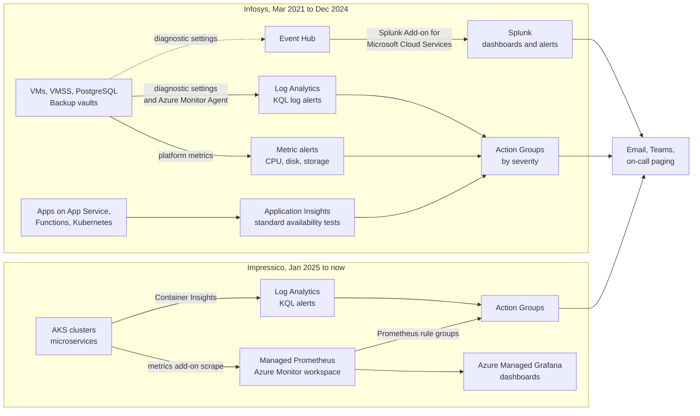

# My Projects: Azure Monitoring, Prometheus and Grafana, and Splunk Alerting

> STAR template for the project where you built Azure Monitor metric and log alerts with KQL, Application Insights availability tests, Action Groups with severity routing, Prometheus and Grafana dashboards on AKS, and Splunk integration for central logs and alerts, with an architecture sketch and likely follow-up questions.

## Key Concepts

Lines marked **From resume:** repeat a claim already on the resume. The rest is a draft answer built from the resume; check every line against what really happened, and replace each `[Confirm: …]` with the real detail.

### Situation

Guiding prompts: How were problems noticed before: by customers, by people watching dashboards, by noisy emails? Were logs spread across many places? Was on-call overloaded with alerts that did not need action?

- This project spans both jobs. At Infosys (Mar 2021 to Dec 2024) I built the Azure Monitor metric and log alerts, the KQL queries, the Application Insights availability tests, the Action Groups with severity routing, and the Splunk integration. At Impressico (Jan 2025 to now) I built the Prometheus and Grafana dashboards for AKS and centralized observability on Azure Monitor, Log Analytics and Application Insights with KQL-based alerting.
- At Infosys we ran healthcare workloads on Azure: Linux and Windows VMs and VM Scale Sets, Azure Database for PostgreSQL, App Service, Azure Functions with Service Bus, Kubernetes workloads, and Azure Backup through Recovery Services Vaults. Before this work, monitoring was mostly default platform metrics in the portal, a few ad hoc email alerts, and logs read directly on servers or in separate tools. At Impressico the AKS clusters had no single place to see cluster and service health.
- The main problem was that we found issues late. A typical case: a nightly VM or PostgreSQL backup job failed, and nobody noticed until someone checked the vault by hand days later. [Confirm this happened, or swap in your own] Application errors were similar: we often heard about them from users before any alert fired.
- It mattered because these were production healthcare systems. Late detection meant longer outages, missed backup RPOs, and on-call engineers who ignored email because most alerts needed no action.

### Task

Guiding prompts: What were you asked to do, or what did you take on? Who were the users of the alerts and dashboards? What were the constraints (cost, existing Splunk contract, team skills)?

- **From resume:** set up Azure Monitor alerting, Prometheus and Grafana on AKS, and Splunk integration for central logs and alerts.
- At Infosys I owned the Azure side: which signals to alert on, the alert rules and KQL, the Action Groups and routing, and getting Azure logs into Splunk. The Splunk platform itself (indexers, licence) belonged to a central team. At Impressico I owned the AKS monitoring stack and the dashboards. [Confirm: team size and who owned the Splunk platform]
- Constraints: Splunk was already the company's central log tool, so we had to feed it rather than replace it; Splunk licence and Log Analytics ingestion are both charged by volume, so we could not send everything everywhere; and alerts had to fit the existing on-call process. Stakeholders were the operations and on-call engineers, the application teams, and the people responsible for backups and compliance.

### Action

Guiding prompts: Which alerts did you create and why? How did severity decide who was notified? How did metrics and logs flow into Prometheus, Grafana, and Splunk? How did you reduce noise?

- **From resume:** Azure Monitor metric alerts and log alerts written in KQL, Application Insights availability tests, and Action Groups with severity-based routing.
- **From resume:** Prometheus and Grafana dashboards on AKS.
- **From resume:** Splunk integration for central logs and alerts.
- Step 1, what to alert on (Infosys). I started from symptoms users feel and from things that silently break: app availability and failed requests, VM health (heartbeat, CPU, disk), VMSS scaling events and scale failures, backup job status, and PostgreSQL CPU, storage and connections. My rule was that every alert needs an owner and a clear action. Things that are only interesting, like a short CPU spike, went on a dashboard, not into an alert.
- Step 2, severity and routing (Infosys). Sev0 and Sev1 (production down, backup failed, availability test failing) went to the on-call engineer by SMS or voice and the paging tool, plus a Teams channel. Sev2 (degradation, high error rate) went to Teams and email. Sev3 and Sev4 (warnings, capacity trends) went to email only. Each level had its own Action Group, and I used alert processing rules to suppress notifications during planned patching windows. [Confirm: paging or ticketing tool used, for example PagerDuty or ServiceNow]
- Step 3, Prometheus and Grafana (Impressico). I enabled Azure Monitor managed service for Prometheus on the AKS clusters, which runs the metrics add-on and stores data in an Azure Monitor workspace, and linked it to Azure Managed Grafana. Dashboards showed cluster and node-pool health (CPU, memory, pod count against limits, node readiness), and per-service golden signals: request rate, error rate, latency percentiles, and saturation. Container Insights sent container logs and Kubernetes events to Log Analytics for KQL alerts. [Confirm: managed Prometheus or self-hosted kube-prometheus-stack with Helm]
- Step 4, logs to Splunk (Infosys). I set diagnostic settings on the Azure resources to stream selected log categories to an Event Hub namespace, and the Splunk Add-on for Microsoft Cloud Services read from the Event Hub into Splunk indexes. Splunk then held the dashboards and some production alerts that correlated logs across systems. [Confirm: Event Hub add-on, HTTP Event Collector, or Universal Forwarder on the VMs]
- Trade-off: I kept fast, numeric alerts (CPU, availability, backup status) in Azure Monitor, close to the resource, and used Splunk for long-term search and cross-system dashboards. Putting every alert in Splunk would have added ingestion delay and doubled licence cost. A problem I hit: some log search alerts missed events because Log Analytics ingestion can lag a few minutes and the query window was too tight. I fixed it by widening the lookback window and adding a delay buffer. [Confirm this happened, or swap in your own]

### Result

Guiding prompts: What measurably improved? Think about time to detect, number of alerts per week, share of alerts that needed action, incidents found by customers vs by monitoring, and log cost.

- From the resume, the Impressico observability work "significantly improved incident detection and reduced MTTR", and it supported the 99.9% availability we sustained on AKS. At Infosys, backup failures and application errors were alerted on automatically instead of being found by hand. I measured this from alert history and incident tickets: time from first alert to resolution, and how many incidents were first raised by monitoring rather than by users. [Confirm: MTTR before and after, and share of incidents found by monitoring]
- Adoption: the on-call and operations engineers used the Action Group notifications and Splunk dashboards day to day, and application teams used the Grafana dashboards for performance tuning and capacity planning.
- Next time I would define all alert rules and Action Groups as code (Bicep or Terraform) from day one, attach a runbook link to every alert, and set service-level objectives first so alerts are based on error budget burn rather than raw thresholds.

### Architecture

Draft based on the resume; adjust to match the real setup.



- Resources to metric alerts: platform metrics are evaluated every minute or few minutes with no extra setup, so CPU, disk and storage alerts are fast and cheap.
- Resources to Log Analytics: diagnostic settings and the Azure Monitor Agent send logs, heartbeats and backup job records; scheduled KQL queries turn them into log alerts.
- Application Insights: standard availability tests call the app from several regions; failures raise an alert.
- Resources to Event Hub to Splunk: selected log categories stream to Event Hub, and the Splunk add-on pulls them into Splunk indexes for search, dashboards and correlated alerts.
- AKS to Prometheus to Grafana: the managed metrics add-on scrapes cluster and app metrics, Grafana reads them, and Prometheus rule groups alert through Action Groups.
- Action Groups to people: each severity has its own Action Group that sends email, posts to Teams, or pages on-call.

### Tech stack

- **From resume:** Azure Monitor, Log Analytics with KQL, Application Insights, Action Groups, Prometheus, Grafana, Splunk, AKS.
- Notification channels: email and SMS or voice from Action Groups, Teams through a webhook or Logic App action, and an on-call paging or ticketing tool through a webhook.
- Alert rules and Action Groups were deployed with reusable Bicep modules in Azure DevOps pipelines, so thresholds and routing were reviewed in pull requests. [Confirm: Bicep, Terraform, or partly the portal]
- Logs reached Splunk through diagnostic settings to Event Hub, read by the Splunk Add-on for Microsoft Cloud Services.

## Interview Questions

<details><summary>Q1. [Basic] Give me a two-minute overview of this project.</summary>

**Answer:**

This work spans my two jobs. At Infosys, from 2021 to 2024, we ran healthcare workloads on Azure: VMs and scale sets, PostgreSQL, App Service, Functions and Kubernetes. Problems were often found late. A failed backup or a broken API could go unnoticed until a user complained or someone checked by hand. My task was to make monitoring proactive and to get Azure logs into Splunk, which was the company's central log tool.

I built metric alerts for numeric signals like CPU, disk and database storage, and KQL log search alerts for things like failed backup jobs, missing VM heartbeats and spikes in failed requests. I added Application Insights standard availability tests from several regions. All alerts went to Action Groups by severity: Sev0 and Sev1 paged on-call and posted to Teams, Sev2 went to Teams and email, and lower levels went to email. I streamed selected logs through Event Hub into Splunk for dashboards and correlated alerts.

To follow one signal: if the login endpoint stopped responding, the availability test failed in three of five regions, the Sev1 alert fired, and the on-call engineer got an SMS and a Teams message with the resource link within a few minutes.

At Impressico, from 2025, I built Prometheus and Grafana dashboards for our AKS clusters and centralized observability on Azure Monitor and Log Analytics with KQL alerts. That significantly improved incident detection and reduced MTTR, and it supported the 99.9% availability we sustained on AKS. We tracked MTTR from alert and ticket timestamps.

**Hints:** follow one signal end to end (for example a failed availability test to the person paged), then give one measured result.

</details>

<details><summary>Q2. [Intermediate] When did you use a metric alert and when did you use a KQL log alert?</summary>

**Answer:**

I used a metric alert whenever the signal was already a number that Azure collects, like VM CPU, disk space or PostgreSQL storage percent. Metric alerts evaluate every minute or few minutes, cost little, and can use dynamic thresholds. For example: average Percentage CPU above 85 for 15 minutes, checked every 5 minutes, Sev2.

I used a KQL log search alert when I needed to find a pattern in logs, join data, or calculate a ratio. For example, failed backup jobs:

```kusto
AddonAzureBackupJobs
| where JobOperation == "Backup" and JobStatus == "Failed"
| summarize Failures = count() by BackupItemUniqueId
```

And an error rate per app, so a single failed request does not fire:

```kusto
AppRequests
| summarize Total = count(), Failed = countif(Success == false) by AppRoleName
| extend FailRate = 100.0 * Failed / Total
| where Total > 50 and FailRate > 5
```

Log alerts are slower and cost more per rule, because they wait for ingestion and run on a schedule, so I used them only where a metric could not do the job.

**Hints:** metric alerts are fast and cheap for numeric signals such as CPU or request count; log search alerts run a KQL query on a schedule and suit patterns in logs, such as a count of errors with a given message.

</details>

<details><summary>Q3. [Intermediate] How did severity routing work with Action Groups?</summary>

**Answer:**

Each alert rule had a severity, and each severity level was linked to its own Action Group. Sev0 is a production outage and Sev1 is a critical failure like a failed backup or a failing availability test. Both went to the on-call Action Group: SMS or voice call, a webhook to the paging tool, and a post in the operations Teams channel. Sev2, which is degradation such as a high error rate, went to Teams and email for the owning team. Sev3 and Sev4 are warnings and capacity trends, and they went to email only, to be reviewed during working hours.

I used alert processing rules for two things. First, to suppress notifications during planned maintenance, for example the OS patching windows we ran with Ansible, so a planned reboot did not page anyone. Second, to add the on-call Action Group to every Sev0 and Sev1 alert in a subscription, so a new rule could not be created without paging. I used the common alert schema so every channel got the same payload format.

**Hints:** cover Sev0 to Sev4 mapped to different Action Groups (for example paging for Sev0 and Sev1, a team channel for lower levels), and alert processing rules if you used them for routing or maintenance windows.

</details>

<details><summary>Q4. [Intermediate] What did your Application Insights availability tests check, and when did they alert?</summary>

**Answer:**

I used standard availability tests, not the old URL ping tests. Each test called a public endpoint, usually the application's health endpoint and the login page, every 5 minutes from five Azure regions. The test checked that the HTTP status was 200, that the response contained an expected string, so an error page with status 200 would still fail, and that the SSL certificate was valid and not close to expiry, so we got a warning before a certificate ran out.

The alert used the availability test's location threshold: it fired only when at least three of the five locations failed in the same window. One region failing is usually a network blip on the test side, not an outage. A failing test was Sev1 and went to the on-call Action Group. The SSL expiry warning was a lower severity and went to email so someone could renew it in normal hours.

**Hints:** mention standard tests from several Azure locations, checking status code and response content or SSL expiry, and alerting only when several locations fail to avoid false alarms. Classic URL ping tests are deprecated (retirement is planned for 30 September 2028), so standard tests are the current choice.

</details>

<details><summary>Q5. [Intermediate] How did you run Prometheus and Grafana for AKS, and what did the dashboards show?</summary>

**Answer:**

At Impressico I used Azure Monitor managed service for Prometheus with Azure Managed Grafana. Enabling the metrics add-on on AKS deploys the collector, and the data goes to an Azure Monitor workspace, so we did not have to run Prometheus storage, high availability or upgrades ourselves. The trade-off is less control: custom scrape configs go through a ConfigMap, and you pay per ingested sample. A self-hosted kube-prometheus-stack installed with Helm gives full control and Alertmanager, but you own its storage, retention and upgrades, which takes real time on every cluster.

The dashboards had two levels. Cluster level: node-pool CPU and memory, pod requests against allocatable capacity, node readiness, and pod restarts. That fed capacity planning and autoscaler tuning. Service level: the golden signals for each microservice, meaning request rate, error rate, p95 and p99 latency, and saturation such as CPU throttling and memory against limits.

**Hints:** know the trade-off between Azure Monitor managed service for Prometheus with Azure Managed Grafana and a self-hosted stack installed with Helm. Good dashboards show the golden signals: latency, traffic, errors, and saturation.

</details>

<details><summary>Q6. [Intermediate] How did Azure logs and alerts get into Splunk?</summary>

**Answer:**

At Infosys we used the Event Hub path. I configured diagnostic settings on the Azure resources, and the Activity Log at subscription level, to stream chosen log categories to an Event Hub namespace, with a separate Event Hub per log type. On the Splunk side, the Splunk Add-on for Microsoft Cloud Services read from those Event Hubs using its own consumer group and wrote into dedicated indexes. I owned the Azure side: diagnostic settings, Event Hub sizing, and access for the add-on. The central Splunk team owned the indexers and licence.

For application logs that needed to reach Splunk directly, the other option is the Splunk HTTP Event Collector with a token.

To control cost I did not stream everything. I picked categories that were useful for search and audit, like Activity Log, Application Gateway access logs and app errors, and I did not send high-volume, low-value logs. Fast alerts stayed in Azure Monitor, so we did not pay twice for the same noise.

**Hints:** a common path is diagnostic settings to Event Hubs, then a Splunk add-on reads the events; another is sending to the Splunk HTTP Event Collector. Mention filtering so you do not pay to store the same noise twice.

</details>

<details><summary>Q7. [Advanced] How did you reduce alert noise?</summary>

**Answer:**

I started by exporting alert history and asking, for each rule, how often did it fire and how often did someone actually do something. Rules that never led to an action were deleted or moved to a dashboard. Every remaining alert had an owner and a runbook link in its description.

Then I tuned rules. I replaced short CPU spikes with averages over 15 minutes, used "number of violations" so a rule fired only after two or three bad evaluations in a row, and tried dynamic thresholds for metrics with a daily pattern. For log alerts I alerted on error rates with a minimum request count instead of raw error counts. I turned on auto-resolve so alerts closed when the condition cleared, split one alert per resource where it helped, and used alert processing rules to suppress planned maintenance. We reviewed the noisiest rules each month. [Confirm: alerts per week before and after]

**Hints:** every alert must need an action, have an owner, and link to a runbook. Mention tuning thresholds and durations, grouping duplicates, and reviewing alert history regularly.

</details>

<details><summary>Q8. [Advanced] An alert did not fire during a real incident. How do you find out why? <em>(scenario)</em></summary>

**Answer:**

[Confirm this happened, or swap in your own] We had an application error spike that the log search alert did not catch.

I work through the chain in order. First, is the rule enabled and scoped to the right resource or workspace? Second, I run the KQL by hand for the incident time. If it returns nothing, the query is wrong, for example a filter on the wrong field. If it returns rows, the logic is fine and the problem is timing or delivery. Third, I check the evaluation frequency and window. In our case the rule ran every 5 minutes over a 5 minute window, and Log Analytics ingestion was a few minutes behind, so the rows arrived after that window had already been evaluated. I fixed it by using a longer window than the frequency and checking the ingestion delay with `ingestion_time()`. Fourth, if the alert fired but nobody was told, I check the Action Group, its test notification, and whether an alert processing rule, such as a forgotten maintenance window, suppressed it.

**Hints:** check the rule is enabled, run the KQL by hand for that time, check evaluation frequency and window, log ingestion delay, the Action Group, and any alert processing rule that suppressed it.

</details>

<details><summary>Q9. [Advanced] How did you control the cost of logs in Log Analytics and Splunk?</summary>

**Answer:**

In Log Analytics I collected only the diagnostic categories we used, not "all logs". I used data collection rules to choose performance counters and event levels, and DCR transformations to drop noisy rows or columns before ingestion. I kept interactive retention short and moved older data to long-term retention for audit. For verbose logs that we only searched now and then, like some container logs, a cheaper table plan such as Basic logs is the right fit. I used the Usage table to find which tables cost the most.

For Splunk, the licence is based on daily ingested volume, so filtering upstream saved the most. I sent only selected categories to Event Hub, and the Splunk team could drop unneeded events at index time. The main rule was not to send the same data to both tools without a reason: fast alert data stayed in Azure Monitor, and Splunk got what we needed for long-term search, audit and cross-system dashboards.

**Hints:** mention collecting only useful categories, retention settings, cheaper table plans for verbose logs, and not sending the same data to both tools without a reason.

</details>

<details><summary>Q10. [Advanced] If you did this project again, what would you change?</summary>

**Answer:**

First, I would put every alert rule, Action Group and alert processing rule into Bicep or Terraform from the start. Early on, some rules were created in the portal, so thresholds drifted between environments and it was hard to see who changed what. Once they were in code, changes went through pull requests and every environment matched.

Second, I would define service-level objectives with the application teams first, then alert on error budget burn rate rather than many separate thresholds. That gives fewer, more meaningful alerts.

Third, I would decide earlier which data belongs in Azure Monitor and which in Splunk. Making that clear sooner would have avoided paying to store some logs twice. What I learned is that monitoring is a product: it needs owners, reviews and code, not only a set of rules.

**Hints:** pick a real limitation, for example alerts deployed by hand instead of as code, and say what you learned.

</details>

See also: [Azure automation, monitoring, and cost](../azure/06-automation-monitoring-and-cost.md), [Prometheus](../monitoring-tools/02-prometheus.md), and [Splunk alerts and dashboards](../splunk/03-alerts-and-dashboards.md).
