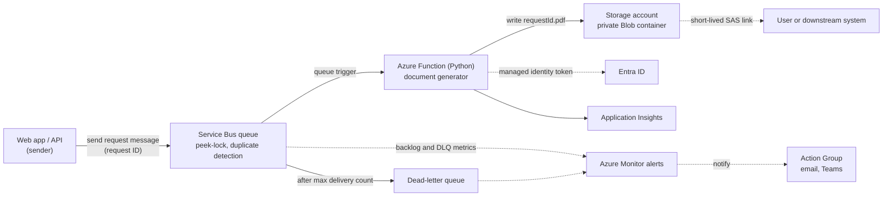

# My Projects: Azure Functions with Service Bus for Document Generation

> STAR template for the project where Azure Functions, triggered by Service Bus messages, processed requests asynchronously and generated documents into a Storage account, with an architecture sketch and likely follow-up questions.

## Key Concepts

Lines marked **From resume:** repeat a claim already on the resume. The rest is a draft answer built from the resume; check every line against what really happened, and replace each `[Confirm: …]` with the real detail.

### Situation

Guiding prompts: What documents were generated and for whom? How was it done before: synchronously in the main app, by a batch job, by hand? What went wrong: timeouts, slow pages, lost requests at peak?

- This was at Infosys, where I worked as a Technology Analyst from March 2021 to December 2024.
- The application let users request generated documents, such as [Confirm: what kind of documents]. Building a document meant loading data, rendering a template, and producing a file, which can take several seconds per request.
- Before, the document was built inside the web request. The user waited on a spinning page, large documents hit HTTP timeouts, and at peak the app servers were busy rendering files instead of serving pages. If a request failed halfway, nothing retried it, so the user had to ask again.
- It mattered because slow or failed documents meant support tickets and unhappy users, and the main app slowed down for everyone while documents were being built.

### Task

Guiding prompts: What was your part: the infrastructure, the pipeline, the function code, or all of it? What were the volume, latency, and reliability needs?

- **From resume:** run Azure Functions triggered by Service Bus that process requests asynchronously and generate documents into a Storage account.
- I developed the Azure Functions and owned the Azure side: the Service Bus namespace and queue, the Function App, the Storage account, the managed identity and role assignments, the Bicep templates, the deployment pipeline, and the alerts. The application developers owned the code that sent the request message and the document templates.
- The goals were: the user gets a fast "request accepted" response, no request is lost, a failed document is retried and then parked for investigation instead of disappearing, and the system copes with peaks of about [Confirm: requests per day and at peak].

### Action

Guiding prompts: How did a request flow from sender to stored document? How were failures, retries, and duplicates handled? How did the function authenticate? How was it deployed and monitored?

- Step 1, the message flow. The app sends a small JSON message to a Service Bus queue, not the document data itself: a request ID, the document type, and the IDs needed to load the data. I set the message ID to the request ID so queue duplicate detection can drop a resend of the same request. I chose a queue, not a topic, because there was exactly one consumer. A topic with subscriptions only pays off when several systems need the same event.
- Step 2, the function settings. The function is written in [Confirm: language, e.g. Python] with a Service Bus queue trigger. The trigger uses peek-lock, so a message is locked, not removed, while the function works on it, and completed only on success. In `host.json` I set `maxConcurrentCalls` to limit how many documents one instance builds at once, and `maxAutoLockRenewalDuration` longer than the slowest document so the lock does not expire mid-render. On the queue, max delivery count is 10 (the default); after 10 failed attempts the message goes to the dead-letter queue. The Function App ran on the [Confirm: hosting plan, e.g. Premium EP1] plan, with the function timeout set above the slowest document.
- Step 3, Storage. Documents are written to a private Blob container, for example `documents/<yyyy>/<MM>/<requestId>.pdf`. Building the name from the request ID makes the write idempotent: a retry writes the same blob name instead of a second copy. Public blob access is disabled on the account. Users or the downstream system get the file through [Confirm: how users get the file, e.g. the app returns a short-lived user delegation SAS link].
- Step 4, identity and networking. The Function App has a managed identity. It connects to Service Bus with an identity-based connection (`ServiceBusConnection__fullyQualifiedNamespace`) and the Azure Service Bus Data Receiver role on the queue, and writes blobs with the Storage Blob Data Contributor role on the container. The sending app has Azure Service Bus Data Sender. No connection strings or keys are stored anywhere. Where the environment needed it, the Function App used VNet integration and the Storage account and Service Bus were reached over private endpoints with Private DNS zones.
- Step 5, deployment and monitoring. Everything was defined in Bicep: the namespace and queue (lock duration, max delivery count, duplicate detection), the Storage account and container, the plan, the Function App and its app settings, and the role assignments. An Azure DevOps YAML pipeline deployed the Bicep, then built the Python package and deployed it with the `AzureFunctionApp` task. For monitoring, the function sent logs to Application Insights, and I set Azure Monitor alerts on the queue's active message count (backlog), the dead-letter message count, and the function failure rate, routed through an Action Group to email and Teams.
- Trade-off: I sent only IDs in the message, not the full data, because Service Bus messages have a size limit (256 KB on Standard) and the data could change. The cost is that the function needs read access to the data source, and the document reflects the data at processing time, not at request time.
- [Confirm this happened, or swap in your own] A problem I hit: some large documents took longer than the queue's lock duration. The lock expired, Service Bus gave the message to another instance, and we saw duplicate work and messages dead-lettered with `MaxDeliveryCountExceeded`. I fixed it by setting `maxAutoLockRenewalDuration` in `host.json` so the host keeps renewing the lock, lowering `maxConcurrentCalls` so one instance was not overloaded, and relying on the request-ID blob name so a repeat did not create a second document.

### Result

Guiding prompts: What measurably improved? Think about response time for the user, failed or lost requests, documents per hour, peak handling, and cost.

- The user now gets an immediate "request accepted" response instead of waiting for the document, requests are no longer lost when generation fails, and peaks build up in the queue instead of slowing down the main app. I measured this with Application Insights: the API request duration before and after the change, plus the Service Bus active and dead-letter message counts. The real numbers were [Confirm: API response time and failed requests, before vs after].
- Next time I would add a status callback from the start (for example, an Event Grid event or a status record when the blob is written) so the app does not need to poll, and I would add a small automated tool to resubmit dead-lettered messages instead of doing it by hand.

### Architecture

Draft based on the resume; adjust to match the real setup.

- App to Service Bus: the app sends a small message with the request ID and returns "accepted" to the user right away.
- Service Bus to Function: the queue trigger locks the message (peek-lock); the function completes it on success or it is retried.
- Function to Storage: the document is written to a private container under a name built from the request ID.
- Service Bus to dead-letter queue: after the max delivery count, a failing message is parked for investigation, not lost.
- Function to Entra ID: the managed identity gets tokens for Service Bus and Storage, so no secrets are stored.
- Monitoring: Application Insights holds function logs; Azure Monitor alerts on backlog, dead-letter count and failures go to the Action Group.

### Tech stack

- **From resume:** Azure Functions, Azure Service Bus, Azure Storage.
- Function code in Python on the Python v2 programming model (language and hosting plan as confirmed in Step 2).
- Bicep for all resources and role assignments, deployed with an Azure DevOps YAML pipeline.
- Application Insights for function logs, Azure Monitor metric and log alerts (KQL) with Action Groups, and Splunk for centralized logs.

## Interview Questions

Q1. [Basic] Give me a two-minute overview of this project.

**Answer:**

At Infosys I built an asynchronous document generation pipeline with Azure Functions and Service Bus. Before, the application generated documents inside the web request. Users waited, big documents timed out, and the app slowed down at peak.

I developed the functions and owned the Azure side. Here is one request from start to finish. The user clicks "generate". The app puts a small JSON message on a Service Bus queue with the request ID and the document type, and immediately tells the user the request is accepted. A Python Azure Function with a Service Bus queue trigger picks up the message in peek-lock mode. It loads the data, renders the document, and writes it to a private Blob container, named after the request ID. If that succeeds, the message is completed. If it fails, Service Bus retries it, and after the max delivery count it moves to the dead-letter queue, so nothing is lost silently.

The function uses a managed identity with Service Bus Data Receiver and Storage Blob Data Contributor roles, so there are no connection strings. I wrote all the resources in Bicep and deployed them with an Azure DevOps YAML pipeline, which also deploys the function code. Application Insights holds the function logs, and Azure Monitor alerts fire on queue backlog, dead-letter count and failures.

The developers owned the sending code and the templates. The result was a fast response for the user, no lost requests, and peaks absorbed by the queue instead of the web servers.

**Hints:** follow one request from send to stored document, and be clear about which parts you owned.

Q2. [Basic] Why process the requests asynchronously with Service Bus instead of a direct HTTP call?

**Answer:**

There were three reasons. First, generating a document takes seconds, sometimes longer for big ones. With a direct HTTP call the caller waits the whole time and can hit a timeout. With a queue, the app sends a message and returns "accepted" in milliseconds, and the document is built in the background.

Second, the queue absorbs peaks. If many users ask for documents at once, the messages simply wait in the queue and the functions work through them at a steady rate. The web app is not slowed down, and the functions scale out on queue length.

Third, reliability. A message in Service Bus is stored durably. If the function is down, being deployed, or throws an error, the message stays in the queue and is retried. After the max delivery count it goes to the dead-letter queue, where we can see it and resubmit it. With a direct call, a failure in the middle just meant a lost request and the user had to try again.

**Hints:** mention that the caller does not wait for slow document generation, the queue absorbs peaks, and messages are not lost if the function is down or fails.

Q3. [Intermediate] What happens when the function fails to process a message?

**Answer:**

The Service Bus trigger receives in peek-lock mode. The message is not deleted; it is locked for this one receiver. If the function returns successfully, the host completes the message and it is removed. If the function throws an exception, the host abandons the message, the lock is released, and the delivery count goes up by one. The message becomes visible again and is retried, possibly on another instance.

On the queue I kept max delivery count at 10. When a message fails the tenth time, Service Bus moves it to the dead-letter queue with the reason <code>MaxDeliveryCountExceeded</code>. It stays there until we look at it, so a bad message cannot block the queue forever.

For long documents, the lock matters. The queue lock duration is at most five minutes. If rendering takes longer and the lock expires, Service Bus hands the message to someone else. So in <code>host.json</code> I set <code>maxAutoLockRenewalDuration</code> longer than the slowest document; the host keeps renewing the lock while the function runs.

**Hints:** cover peek-lock, the message being retried until it reaches the queue's max delivery count, then moving to the dead-letter queue, and lock renewal for long-running work.

Q4. [Intermediate] How did you make sure a message processed twice did not create a wrong or duplicate document?

**Answer:**

Service Bus guarantees at-least-once delivery, not exactly-once. A message can come twice, for example when a lock expires or the function crashes after writing the blob but before the message is completed. So the handler has to be idempotent.

I did it in two layers. On the sending side, the message ID is the request ID, and the queue has duplicate detection turned on. If the app resends the same request within the detection window, Service Bus drops the copy.

On the processing side, the blob name is built from the request ID, like <code>documents/2024/05/&lt;requestId&gt;.pdf</code>. Before rendering, the function checks if that blob already exists; if it does, it logs it and returns success. The upload itself uses <code>overwrite=False</code>, so if two instances race, the second gets a "blob already exists" error, which I treat as success. That way a repeat never creates a second document and never overwrites a good one with a half-written one.

**Hints:** Service Bus gives at-least-once delivery, so the handler must be idempotent. Examples: a document name built from a request ID, checking if the blob already exists, or duplicate detection on the queue.

Q5. [Intermediate] How did the function authenticate to Service Bus and Storage?

**Answer:**

With a managed identity, so there were no connection strings or keys in app settings or Key Vault for this.

For the trigger, instead of a connection string setting, I used an identity-based connection. The app setting is <code>ServiceBusConnection__fullyQualifiedNamespace</code> set to <code>&lt;namespace&gt;.servicebus.windows.net</code>, and the trigger's <code>connection</code> property points to <code>ServiceBusConnection</code>. The Functions host then gets a token from Entra ID with the app's managed identity. That identity has the Azure Service Bus Data Receiver role, scoped to the queue only.

For writing documents, the Python code uses <code>DefaultAzureCredential</code> with the <code>BlobServiceClient</code>, and the identity has Storage Blob Data Contributor on the documents container. The host's own storage uses <code>AzureWebJobsStorage__accountName</code> with the identity too. The sending app has only Azure Service Bus Data Sender. All role assignments were in Bicep, so they were reviewed and repeatable, which matches the least-privilege approach I used across Infosys.

**Hints:** a strong answer uses a managed identity with identity-based connections (for example a <code>__fullyQualifiedNamespace</code> setting) and data-plane roles such as Azure Service Bus Data Receiver and Storage Blob Data Contributor, instead of connection strings.

Q6. [Intermediate] Which hosting plan did you use, and why?

**Answer:**

We used the plan noted in Step 2 above. Here is how I compared the options.

The classic Consumption plan is cheapest, but it has cold starts, a 10-minute maximum run time, and no VNet integration. Microsoft now treats it as legacy, and Linux Consumption is being retired, so for new work I would not pick it.

Premium (Elastic Premium) keeps at least one warm instance, so there are no cold starts, supports VNet integration for private endpoints, and has no hard run-time limit (60 minutes is guaranteed). It costs more because you always pay for the minimum instances. It also supports deployment slots.

Dedicated (App Service plan) makes sense only if you already have spare App Service capacity; it does not scale on queue length as well.

Flex Consumption, generally available since late 2024, is what I would choose today: pay per use, VNet integration, optional always-ready instances against cold starts, and long run times. Our documents took seconds to a few minutes and needed private networking, and Flex Consumption was not yet available for most of the project, which is why Premium was the safe choice at the time.

**Hints:** compare cold starts, scaling limits, maximum run time, and VNet integration across Flex Consumption, Premium, and Dedicated plans, and tie the choice to your document sizes and volume.

Q7. [Advanced] How did you monitor the pipeline and know it was healthy?

**Answer:**

I looked at it from both ends: the queue and the function.

On Service Bus, the key metrics are active messages, which is the backlog, and dead-lettered messages, filtered by the queue name. A healthy system has a backlog that goes up at peak and drains back to near zero. So I alerted on a backlog that stays high for a period, not just a single spike, because a growing backlog means the functions are stuck or too slow even when no errors are logged. Any new dead-lettered message raised a separate alert.

On the function, Application Insights records each execution. I watched failure count, duration, and exceptions with KQL queries on the requests and exceptions tables, and alerted on failure rate. Duration trends also told me when documents were getting close to the lock or timeout limits.

All alerts went through Action Groups to email and Teams, with severity set so a dead-letter spike paged faster than a slow drift. Logs were also sent to Splunk alongside our other workloads.

**Hints:** watch the active message count (backlog), the dead-letter message count, function failures and duration in Application Insights, and alert on a growing backlog, not only on errors.

Q8. [Advanced] After a deployment the dead-letter queue starts filling up. What do you do? <em>(scenario)</em>

**Answer:**

[Confirm this happened, or swap in your own] First, I would confirm the timing: did the dead-letter count start rising right after the deployment? Then I would peek a few dead-lettered messages in Service Bus Explorer in the portal and read the <code>DeadLetterReason</code> and <code>DeadLetterErrorDescription</code>. <code>MaxDeliveryCountExceeded</code> means the function kept failing, so I go to Application Insights and look at the exceptions for that function since the deployment. Typical causes are a missing app setting, a missing role assignment, or a code change that breaks on a certain document type.

If the cause is not a quick fix, I roll back: redeploy the previous build from the pipeline, or swap the slot back. Otherwise I fix forward through the pipeline. Messages already in the dead-letter queue are safe; they do not expire there.

Once the fix is live and new messages succeed, I resubmit the dead-lettered ones, either from Service Bus Explorer or with a small Python script that reads the dead-letter sub-queue, sends each message back to the main queue, and completes the dead-letter copy. Because the handler is idempotent, resubmitting is safe. Finally, I add a test for that case to the pipeline so it cannot ship again.

**Hints:** read the dead-letter reason and the function exceptions, roll back or fix forward, then resubmit the dead-lettered messages once the fix is live, and add a test that would have caught it.

Q9. [Advanced] If you did this project again, what would you change?

**Answer:**

Two things. First, resubmitting dead-lettered messages was a manual step. It worked, but it depended on someone remembering how to do it. Next time I would build a small, tested resubmit tool from day one, run from the pipeline with an approval, and write a runbook for it.

Second, the app had to poll to know when a document was ready. I would publish a "document ready" event when the blob is written, for example with Event Grid's BlobCreated event or a status record, so the app can notify the user right away.

I would also look at Flex Consumption instead of Premium, because it now gives VNet integration and always-ready instances while charging per use, which would reduce the cost of idle warm instances. What I learned is that the reliability features, like dead-lettering and idempotency, are only half the job; the operational tooling around them matters just as much.

**Hints:** pick a real limitation and say what you learned; avoid "nothing".

See also: [Azure integration and messaging](../azure/03-integration-and-messaging.md) and [Azure compute and app hosting](../azure/02-compute-and-app-hosting.md).
