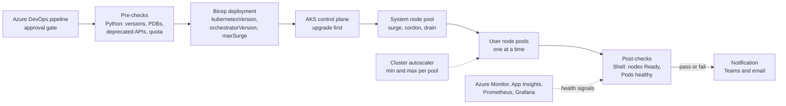

# My Projects: AKS Node Pools and Zero-Downtime Upgrades

> STAR template for the project where you managed AKS node pools, the cluster autoscaler, and rolling, zero-downtime Kubernetes version upgrades with Bicep and Shell/Python scripts, with an architecture sketch and likely follow-up questions.

## Key Concepts

Lines marked **From resume:** repeat a claim already on the resume. The rest is a draft answer built from the resume; check every line against what really happened, and replace each `[Confirm: …]` with the real detail.

### Situation

Guiding prompts: Which clusters and environments were in scope? How were upgrades done before? Were there outages, failed upgrades, or clusters falling out of the supported Kubernetes version window? What kind of workloads ran on the clusters?

- This was at Impressico Business Solutions, where I have worked as a DevOps Engineer since January 2025.
- We ran AKS clusters for dev, staging and prod, [Confirm: number of clusters and node pools per cluster]. Each cluster had a system node pool for core add-ons and user node pools for the business microservices, which were deployed with Helm charts from ACR.
- Before this work, upgrades were done by hand from the portal or with one-off <code>az aks upgrade</code> commands that upgraded the control plane and all node pools in one go. Nothing checked PodDisruptionBudgets, deprecated APIs or quota first. [Confirm this happened, or swap in your own] On one upgrade a single-replica service went down while its node was drained, and another upgrade stalled because a PDB allowed zero disruptions.
- It mattered because AKS supports only a small window of minor versions. A cluster that falls behind loses support, and the services were business-critical, so we could not take long outages to catch up.

### Task

Guiding prompts: What were you asked to do, or what did you take on yourself? What were the constraints: maintenance windows, change approvals, team size, budget?

- **From resume:** manage AKS node pools, the cluster autoscaler, and rolling updates, and run zero-downtime Kubernetes version upgrades.
- I owned the upgrade process end to end: the Bicep templates for the clusters and agent pools, the Shell and Python scripts for pre-checks, ordering and post-checks, and running the production upgrades. Application teams owned their Helm charts, but I set the rules their workloads had to meet before an upgrade. [Confirm: team size and who else worked on it]
- Constraints: production changes needed an approved change request and a maintenance window, the on-call engineer had to be told before and after, and we had to stay inside the existing subscription vCPU quota and budget, so surge nodes had to be planned.

### Action

Guiding prompts: What did you build or change, step by step? How did the Bicep and the scripts split the work? How did you protect running workloads during node drain? Which options did you reject?

- **From resume:** used Bicep together with Shell/Python scripts to upgrade node pools in a controlled way.
- Step 1, pre-checks. A Python script ran <code>az aks get-upgrades</code> to confirm the target version was a supported next step, checked for deprecated API use (Prometheus metric <code>apiserver_requested_deprecated_apis</code> and a scan of Helm release manifests), listed every PDB with <code>kubectl get pdb -A</code> and flagged any with zero allowed disruptions, flagged Deployments with one replica, and checked regional vCPU quota with <code>az vm list-usage</code> so surge nodes would fit.
- Step 2, ordering. I set <code>kubernetesVersion</code> in the Bicep parameter file and ran <code>az aks upgrade --control-plane-only</code> first. Then I raised <code>orchestratorVersion</code> on one agent pool at a time: the system pool first, then each user pool. After each pool the Shell script waited for <code>provisioningState</code> to be <code>Succeeded</code>, all nodes to be <code>Ready</code> on the new version, and no Pods stuck in <code>Pending</code> or <code>CrashLoopBackOff</code> before moving on.
- Step 3, pool settings. Each agent pool had <code>upgradeSettings.maxSurge</code> set in Bicep (for example 33% on user pools, a single node on the small system pool), plus a drain timeout. The system pool had the <code>CriticalAddonsOnly=true:NoSchedule</code> taint so only add-ons ran there. User pools had the cluster autoscaler on with a min and max per pool, sized so surge plus autoscaler headroom stayed under quota.
- Step 4, testing and runbook. Every upgrade ran in dev first, then staging, with the same pipeline and the same scripts, and we let it soak for some days before prod. The prod runbook listed the change number, the go/no-go checks, who to call, and the fallback.
- Trade-off: I chose in-place rolling upgrades with surge for most pools because they are cheaper and simpler. For pools running stateful or sensitive workloads I used a blue/green node pool: create a new pool on the new version, cordon and drain the old pool, then delete it. It costs double capacity for a short time, but gives a cleaner fallback, because you can uncordon the old pool if the new one misbehaves.
- [Confirm this happened, or swap in your own] A problem: a node upgrade stalled because one service had a PDB with <code>minAvailable</code> equal to its replica count, so the drain could never evict a Pod. I found it from the node events and <code>kubectl get pdb -A</code>, worked with the app team to scale it to more replicas, and the drain then finished. After that the pre-check script blocked the upgrade if any PDB allowed zero disruptions.

### Result

Guiding prompts: What measurably improved? Think about availability during upgrades, upgrade duration, manual steps removed, failed upgrades, and how far behind the supported versions the clusters were.

- **From resume:** 99.9% availability on AKS.
- How it was measured: the SLI was the share of successful health checks (or successful requests) for the customer-facing endpoints, over a rolling 30-day window, taken from Application Insights availability tests and the Prometheus and Grafana dashboards. 99.9% over 30 days allows about 43 minutes of downtime. [Confirm: the real source of the 99.9% figure]
- Other outcomes: all clusters were brought back into the supported version window, upgrades became a repeatable pipeline run instead of a manual portal task, and the pre-checks caught blocking PDBs and deprecated APIs before they could stall prod. [Confirm: upgrade time per cluster before and after]
- Next time I would move patch versions and node images to the AKS auto-upgrade channels with a planned maintenance window, and keep the scripted process only for minor version upgrades.

### Architecture

Draft based on the resume; adjust to match the real setup.

- Pipeline to pre-checks: a gated Azure DevOps run starts the Python checks, which stop the run if any check fails.
- Pre-checks to Bicep to control plane: the Bicep deployment sets the new version, and the control plane is upgraded before any nodes.
- Control plane to system pool to user pools: pools are upgraded one at a time, each with surge nodes, cordon and drain.
- Monitoring to post-checks: the scripts and the on-call engineer use health signals to confirm no errors before the next pool.
- Post-checks to notification: the result goes to the team and on-call, and the autoscaler keeps user pools sized during and after the upgrade.

### Tech stack

- **From resume:** AKS, Bicep, Shell, Python.
- The scripts ran on a self-hosted Azure DevOps agent inside the VNet, so they could reach the private API server. They signed in through a service connection backed by a managed identity, and used <code>kubelogin</code> for Entra ID authentication to the cluster, so no secrets were stored in the pipeline.
- Monitoring to prove there was no downtime: Application Insights availability tests and request failure rates, Azure Monitor Container Insights for node and Pod state, and Prometheus and Grafana dashboards for the services.
- [Confirm: AKS version range you upgraded between, and the node OS (Ubuntu or Azure Linux)]

## Interview Questions

Q1. [Basic] Give me a two-minute overview of this project.

**Answer:**

At Impressico I look after the AKS clusters for dev, staging and prod. When I joined, upgrades were done by hand: someone ran one upgrade command for the whole cluster, with no checks first. That caused trouble, for example a drain that stalled on a strict PodDisruptionBudget, and the clusters were drifting towards the end of the supported version window.

My task was to make node pool management and Kubernetes upgrades safe and repeatable, with no downtime for the business services.

I split the work between Bicep and scripts. Bicep holds the desired state: the cluster version, the version of each agent pool, surge settings, and autoscaler min and max. Shell and Python scripts handle what Bicep cannot: pre-checks, ordering and waiting. Before an upgrade, the scripts confirm the target version is available, look for deprecated APIs, flag PDBs that allow zero disruptions and single-replica Deployments, and check vCPU quota for surge nodes. Then we upgrade the control plane first, then the system pool, then each user pool one at a time. After each pool, the script waits until all nodes are Ready on the new version and Pods are healthy before it moves on. Everything runs in dev and staging first, through the same Azure DevOps pipeline, with an approval gate for prod.

The result is that upgrades became a routine pipeline run, the clusters stay inside the support window, and we sustained 99.9% service availability. We measured that as the success rate of Application Insights availability tests and request metrics over a rolling 30-day window.

**Hints:** keep Situation and Task short; spend most of the time on what you did and end with the 99.9% availability and how you measured it.

Q2. [Intermediate] Walk me through one node pool upgrade, step by step, as your process ran it.

**Answer:**

First the pre-checks pass, and the control plane is already on the target version, because a node pool cannot be newer than the control plane. Then I change <code>orchestratorVersion</code> for that one pool in the Bicep parameters and deploy, or run <code>az aks nodepool upgrade --kubernetes-version</code> with <code>--max-surge</code>. AKS adds the surge nodes first on the new version. Then it cordons an old node so nothing new is scheduled on it, and drains it, which evicts Pods while respecting their PDBs. The Deployments recreate those Pods on the surge or other nodes, and readiness probes decide when they get traffic. Then the old node is reimaged or removed, and AKS moves to the next batch. My script polls the pool until <code>provisioningState</code> is <code>Succeeded</code>, checks every node is Ready on the new version, and checks there are no Pending or crashing Pods and no error spike in monitoring. Only then does it start the next pool.

A Kubernetes version upgrade changes the kubelet version and also gives a new node image. A node image upgrade, <code>--node-image-only</code>, only patches the OS image and keeps the same Kubernetes version.

**Hints:** a strong answer covers the control plane before node pools, surge nodes added first, each old node cordoned and drained, Pods rescheduled, and health checks before moving to the next pool. Know the difference between a Kubernetes version upgrade and a node image upgrade.

Q3. [Intermediate] Why did you use Bicep plus Shell/Python scripts, instead of only <code>az aks upgrade</code> or an auto-upgrade channel?

**Answer:**

Bicep is our source of truth. The cluster's <code>kubernetesVersion</code>, each agent pool's <code>orchestratorVersion</code>, <code>maxSurge</code>, VM size, and autoscaler min and max all live in the template and parameter files, reviewed through pull requests. If someone upgraded only with <code>az aks upgrade</code>, the next Bicep deployment would not match the cluster, so we would get drift.

But Bicep is declarative. It does not decide order, wait for health, or check PDBs and deprecated APIs. The scripts own that: pre-checks, upgrading one pool at a time, waiting, and post-checks.

I looked at auto-upgrade channels such as <code>patch</code> or <code>stable</code> with a planned maintenance window. They are good, but for minor version upgrades we wanted control: the change board needed a dated change, we wanted dev and staging to go first, and we needed our own checks before prod. Auto-upgrade also does not know our app-level rules. I would still use the node OS channel for security patches, and that is what I would extend next.

**Hints:** a strong answer says Bicep holds the desired state (for example the version and settings of each agent pool) while scripts handle ordering, waiting, and validation. Mention the options you rejected, such as auto-upgrade channels with a planned maintenance window, and why.

Q4. [Intermediate] How did you make sure applications stayed up while nodes were drained?

**Answer:**

I agreed a few rules with the app teams and the pre-check script enforced them. Every production Deployment needed at least two replicas, so one Pod could be evicted while another served traffic. Each needed a PodDisruptionBudget, usually <code>maxUnavailable: 1</code>, so a drain could never take all replicas at once. Each needed a readiness probe, so new Pods only got traffic once they were really ready, and a graceful shutdown inside <code>terminationGracePeriodSeconds</code>. And we spread replicas with <code>topologySpreadConstraints</code> or pod anti-affinity across nodes and availability zones, so one drained node did not hold every copy.

The script also looked for the opposite problem: a PDB that allows zero disruptions, for example <code>minAvailable</code> equal to the replica count. That blocks the drain and stalls the upgrade, so we fixed it before starting. Surge nodes meant there was spare capacity for evicted Pods to land on straight away.

**Hints:** mention at least two replicas, PodDisruptionBudgets, readiness probes, and spreading Pods across nodes or zones. Know that a PDB that allows zero disruptions blocks the drain and stalls the upgrade.

Q5. [Intermediate] How did you set up node pools and the cluster autoscaler?

**Answer:**

Each cluster had a system pool in <code>System</code> mode, tainted with <code>CriticalAddonsOnly=true:NoSchedule</code>, for CoreDNS, metrics-server and other add-ons. It ran at least three nodes across availability zones in prod, because if the system pool fails the whole cluster suffers. Application workloads ran on user pools, split by workload type, for example general services and heavier jobs, with labels and taints so Pods landed on the right pool.

The cluster autoscaler was enabled per user pool with <code>az aks nodepool update --enable-cluster-autoscaler --min-count --max-count</code>, and the same values were in Bicep. The min covered normal load plus enough room to survive losing a node. The max was set from peak load seen in Grafana and capped by our budget.

During an upgrade, surge nodes are extra VMs on top of the current count, so I checked that max count plus surge fitted inside the regional vCPU quota. Otherwise the upgrade fails partway with a quota error.

**Hints:** cover system vs user node pools, why each pool had its min and max, and how surge nodes during an upgrade relate to subscription quota and the autoscaler.

Q6. [Advanced] An upgrade gets stuck halfway because one node will not drain. What do you do? <em>(scenario)</em>

**Answer:**

First I find what is blocking. <code>kubectl get nodes</code> shows which node is cordoned, <code>kubectl get pods -A -o wide</code> shows what is still on it, and <code>kubectl get pdb -A</code> shows any PDB with zero allowed disruptions. Node and Pod events usually name the eviction that keeps failing. I also check the pool with <code>az aks nodepool show</code> to see the <code>provisioningState</code> and whether the operation has failed or is still running.

Then I fix the cause, not the symptom. Usually that means scaling the Deployment up so the PDB allows an eviction, or agreeing with the app owner to relax the PDB for the window. Then I rerun <code>az aks nodepool upgrade</code> on the same pool, which carries on from where it stopped.

A Kubernetes version upgrade cannot be rolled back in place, so the fallback is a fix-forward, or creating a new node pool and moving workloads to it. [Confirm this happened, or swap in your own] We had this with a single-replica service whose PDB blocked the drain; scaling it to two replicas fixed it, and we then added that check to the pre-checks.

**Hints:** a strong answer covers finding the blocking Pod or PDB with <code>kubectl get pdb -A</code> and events, checking the node pool provisioning state, and knowing that a Kubernetes version upgrade cannot be rolled back in place, so the fallback is a fix-forward or a new node pool.

Q7. [Advanced] How did you check for deprecated or removed Kubernetes APIs before a version upgrade?

**Answer:**

I checked three places. First, the manifests and Helm charts in Git: a Python script rendered each chart with <code>helm template</code> and compared every <code>apiVersion</code> and kind against the APIs removed in the target version, taken from the Kubernetes deprecation guide and the AKS release notes. Second, the live Helm releases: <code>helm get manifest</code> for each release, because a stored release can still reference an old API even after the chart is fixed. Third, the live cluster: the API server metric <code>apiserver_requested_deprecated_apis</code> in Prometheus shows if any client is still calling a deprecated API, for example an old controller or script.

AKS also has its own guard. If it sees recent use of deprecated APIs, it stops the upgrade. You can override that with <code>az aks update --enable-force-upgrade --upgrade-override-until</code>, but we treated that as a last resort and fixed the callers instead. Anything found went back to the app team as a chart change, tested in dev before the upgrade went ahead.

**Hints:** mention scanning manifests and Helm releases for removed APIs, reading the AKS release notes, and that AKS can stop an upgrade when it sees recent use of deprecated APIs.

Q8. [Advanced] How exactly did you measure the 99.9% availability?

**Answer:**

The SLI was service availability as a user sees it, not node uptime. We used Application Insights standard availability tests that called each service's health endpoint through Application Gateway every few minutes from several locations. A check counted as down if it failed or timed out from more than one location. We backed that up with the request success rate (non-5xx responses over total) from Application Insights and Prometheus, shown in Grafana.

The window was a rolling 30 days, reported monthly. 99.9% over 30 days allows about 43 minutes of downtime, so one bad upgrade could use most of the budget, which is why we upgraded one pool at a time.

It is not the AKS uptime SLA. That SLA covers only the API server, not our applications. Planned maintenance counted as downtime if users saw errors, since the point was zero-downtime upgrades.

**Hints:** 99.9% over 30 days allows about 43 minutes of downtime. Say whether the number came from synthetic checks, request success rate, or the AKS uptime SLA, and be honest if it is an estimate.

Q9. [Advanced] If you did this project again, what would you change?

**Answer:**

Two things. First, I would automate more of the routine work. Patch versions and node image upgrades do not need the full manual process, so I would turn on the <code>patch</code> auto-upgrade channel and the <code>NodeImage</code> or <code>SecurityPatch</code> node OS channel with a planned maintenance window defined in Bicep, and keep our scripted pipeline only for minor version upgrades.

Second, I would build the workload checks in earlier. The PDB and replica-count checks were added after a drain got stuck, not from day one. I would now enforce them at deploy time with Azure Policy for AKS (AKS Deployment Safeguards are built on it), for example requiring readiness probes and valid PDBs, plus a pipeline check that blocks single-replica Deployments in prod, so problems are caught when the chart is merged, not on upgrade night.

What I learned is that most upgrade failures are workload problems, not AKS problems, so the real work is getting the app teams' manifests right.

**Hints:** pick a real limitation, for example manual steps that stayed manual or a check you added only after a problem, and say what you learned.

See also: [Kubernetes upgrades and deployments](../../kubernetes/07-deployments-upgrades-cicd.md), [Scheduling and autoscaling](../../kubernetes/05-scheduling-resources-autoscaling.md), and [Bicep fundamentals](../../bicep/01-fundamentals-and-structure.md).
