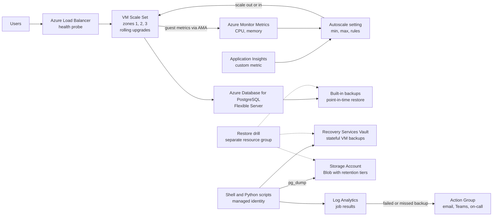

# My Projects: VM Scale Set Autoscaling and Backup Automation

> STAR template for the project where you set up VM Scale Set autoscaling with rolling upgrades and availability zones, and automated backups with Shell/Python, Recovery Services Vault, PostgreSQL backups, restore drills, and failure notifications, with an architecture sketch and likely follow-up questions.

## Key Concepts

Lines marked **From resume:** repeat a claim already on the resume. The rest is a draft answer built from the resume; check every line against what really happened, and replace each `[Confirm: …]` with the real detail.

### Situation

Guiding prompts: What ran on the VMs and how was capacity handled before? Were there slowdowns at peak, wasted cost at quiet times, or risky manual patching? How were backups done, and had anyone tested a restore?

- This was at Infosys, where I was a Technology Analyst from March 2021 to December 2024, on the Azure platform work for the client.
- The scale sets ran VM-based application tiers (Linux and Windows) behind a load balancer, with Azure Database for PostgreSQL as the data store. Traffic was busy in business hours and quiet at night and at weekends. [Confirm: which application ran on the scale sets and its real traffic pattern]
- Before, instance counts were fixed and changed by hand. We sized for peak, so we paid for idle VMs at night, and still had to add capacity manually on unusual peaks. Patching meant reimaging or updating instances by hand. Backups were enabled, but checking them meant someone opening the portal, and restores were not tested on a schedule.
- It mattered because slow pages at peak hurt users, idle VMs cost money, and nobody could prove we could meet our recovery targets if we lost a VM or the database.

### Task

Guiding prompts: What were you asked to do, or what did you take on? What were the RPO and RTO targets, if any? What were the constraints?

- **From resume:** configure VM Scale Set autoscaling and automate backups with Shell and Python.
- I owned the reusable Bicep modules for the scale sets, the autoscale settings, the rolling upgrade policy, and the backup and validation scripts. The application team owned the health endpoint and told us which app metric meant "busy". Operations received the alerts.
- Targets: meet the agreed RPO and RTO, keep a sensible minimum capacity in every zone, and do changes inside the agreed maintenance windows. [Confirm: RPO and RTO targets]

### Action

Guiding prompts: Which metrics drove scaling and why? How were rolling upgrades and zones configured? What exactly did the backup scripts do, and how were failures reported? How did restore drills work?

- **From resume:** VMSS autoscale on CPU, memory, and custom metrics, with a rolling upgrade policy and availability zones.
- **From resume:** Shell/Python backup automation with Recovery Services Vault, PostgreSQL backups, restore drills, and failure notifications.
- Step 1, autoscale rules. I defined the autoscale setting in Bicep next to the scale set, with a minimum of at least one instance per zone and a maximum below our vCPU quota. Scale out by 2 when average CPU is above about 70% for 10 minutes, scale in by 1 when it is below about 30% for 15 minutes, with a 5-minute cooldown on scale-out and a longer one on scale-in. The same rules with the CLI look like `az monitor autoscale create --resource-type Microsoft.Compute/virtualMachineScaleSets --min-count 3 --max-count 10 --count 3` and `az monitor autoscale rule create --condition "Percentage CPU > 70 avg 10m" --scale out 2 --cooldown 5`. [Confirm: real min, max and thresholds]
- Step 2, memory and custom metrics. Memory is a guest OS metric, so Azure does not see it from the host. I installed the Azure Monitor Agent on the scale set through the Bicep module and linked a data collection rule that sends guest performance counters to Azure Monitor Metrics. They then show up under the "Virtual Machine Guest" namespace, and the autoscale rule can use them. For the custom metric, the app sent a metric to Application Insights (for example requests or queue depth), and an autoscale rule can point at that resource's metric instead of the scale set.
- Step 3, rolling upgrades. I set `upgradePolicy.mode` to `Rolling` with about 20% per batch, a max unhealthy of 20%, a max unhealthy upgraded of 20%, and a short pause between batches. Rolling mode needs a health signal, so we added the Application Health extension pointing at the app's `/health` endpoint (a load balancer health probe works too). Instances were spread across zones 1, 2 and 3. Image updates went out with `az vmss rolling-upgrade start`, and Azure stops the rollout if too many upgraded instances turn unhealthy.
- Step 4, backup scripts. Standalone stateful VMs were protected in a Recovery Services Vault with a daily policy and daily, weekly and monthly retention tiers (`az backup protection enable-for-vm`). The scale set instances themselves were stateless and rebuilt from the image, so we did not back them up. A Python script ran daily with a managed identity (`az login --identity`), listed jobs with `az backup job list --status Failed`, checked that every protected item had a fresh recovery point (`az backup recoverypoint list`), and checked the PostgreSQL backups. A Shell script handled the database dumps and log collection. Each script logged to Log Analytics and exited non-zero on any problem. [Confirm: where the scripts ran, cron on an ops VM or a scheduled pipeline]
- Step 5, restore drills. On a schedule, a script restored a VM recovery point into a separate drill resource group (`az backup restore restore-disks`, then create a VM from the disks), and restored PostgreSQL to a new server with `az postgres flexible-server restore --restore-time`. It then ran checks: the VM boots and the app answers on `/health`, and the database has the expected tables and recent rows. The script recorded the start and end time, the result, and then deleted the drill resource group.
- Trade-off: I chose to scale out fast and scale in slowly. That costs a bit more in quiet periods, but it avoids flapping and slow pages at the start of a peak. [Confirm this happened, or swap in your own] Problem: after a scale-out, new instances did not report memory for a while, because the agent and data collection rule association were not yet in place, so the memory rule saw fewer data points. I fixed it by defining the agent extension and the data collection rule association at the scale set level in Bicep, so every new instance gets them at creation.

### Result

Guiding prompts: What measurably improved? Think about peak performance, cost at quiet times, backup success rate, restore time measured in drills, and manual work removed.

- The scale sets now added capacity at peak on their own and shrank at quiet times, which trimmed idle compute cost. Manual backup checks were replaced by a daily script and alerts. I measured this with the autoscale run history and the scale set's cost in Cost Management before and after, plus the backup job history in the vault. [Confirm: before and after numbers, if you have them]
- Restore drills showed that VM and PostgreSQL restores worked and that the time to restore was within the RTO. Each drill recorded the time taken and the data checks that passed. [Confirm: measured restore times from the drills]
- I do not link this project to the 25% cloud cost reduction. The resume ties that number to Terraform/Bicep provisioning, right-sizing and lifecycle cleanup. Autoscale helped with idle cost, but I have not measured its share separately.
- Next time I would use Flexible orchestration, and use Azure Backup vault long-term retention for PostgreSQL instead of maintaining our own dump scripts.

### Architecture

Draft based on the resume; adjust to match the real setup.

- Users reach the scale set through the load balancer, which only sends traffic to instances that pass the health probe.
- The Azure Monitor Agent sends guest metrics such as memory to Azure Monitor Metrics; together with host CPU and the Application Insights metric, they feed the autoscale setting, which adds or removes instances.
- The scripts check Recovery Services Vault jobs, take PostgreSQL dumps to Blob, and write results to Log Analytics; alert rules there send failed or missed backups to the Action Group.
- Restore drills restore from the vault, from PostgreSQL point-in-time restore, and from the dumps into a separate resource group, then check and delete it.

### Tech stack

- **From resume:** Azure VM Scale Sets, autoscale, availability zones, Recovery Services Vault, Azure Database for PostgreSQL, Shell, Python.
- Uniform orchestration, because at the time rolling upgrades and automatic OS image upgrades were most mature on Uniform. Today Flexible is the default for new scale sets and supports rolling upgrades too. [Confirm: Uniform or Flexible]
- Scripts ran on a schedule and logged in with a managed identity (`az login --identity`) with least-privilege roles: Backup Reader on the vault for the daily checks, Storage Blob Data Contributor on the dump container, and, for the drill identity only, Backup Operator plus Contributor on the drill resource group. No secrets were stored in the scripts.
- Notifications went through Azure Monitor alert rules and Action Groups to email, Teams and the on-call channel, with severity-based escalation.

## Interview Questions

Q1. [Basic] Give me a two-minute overview of this project.

**Answer:**

At Infosys I worked on VM-based application tiers on Azure, with Azure Database for PostgreSQL behind them. There were two problems. Capacity was fixed and changed by hand, so we paid for idle VMs at night and still scrambled at unusual peaks. And backups were enabled, but nobody checked them every day or tested a restore.

For scaling, I built the scale sets with reusable Bicep modules, spread across three availability zones. I set up autoscale on CPU, on memory, and on an application metric. Memory is a guest metric, so I added the Azure Monitor Agent and a data collection rule to send it to Azure Monitor Metrics. The rules scale out fast and scale in slowly, with cooldowns, so they do not flap. I set a rolling upgrade policy with batches of about 20% and the Application Health extension as the health signal, so image updates go out without downtime.

For backups, stateful VMs were protected in a Recovery Services Vault with daily, weekly and monthly retention. PostgreSQL used its built-in point-in-time restore plus scheduled dumps to Blob storage. Python and Shell scripts, running with a managed identity, checked every job and recovery point each day and alerted through Action Groups on a failed or missed backup. We also ran scheduled restore drills into a separate resource group.

The result: capacity followed demand, manual backup checks went away, and the drills showed we could restore within our RTO.

**Hints:** cover scaling and backups as two clear parts, and end with a result from a real restore drill.

Q2. [Intermediate] How did you autoscale on memory when Azure only gives CPU as a host metric?

**Answer:**

Right, the host can see CPU, disk and network, but not memory use inside the OS. Memory is a guest metric, so it has to be collected from inside the VM first.

I added the Azure Monitor Agent extension to the scale set model in Bicep, and linked a data collection rule that collects the memory performance counter and sends it to the Azure Monitor Metrics destination, not only to Log Analytics. Once it is in Metrics, it appears under the "Virtual Machine Guest" namespace for the scale set, and the autoscale rule can use it like CPU, with a threshold, an average over a time window, and a cooldown. Older setups did the same with the diagnostics extension.

For the custom metric, the app sent a metric to Application Insights. An autoscale rule can read a metric from another resource, so one rule pointed at that Application Insights metric.

One thing I learned: the agent and the rule association must be part of the scale set model, so every new instance reports memory as soon as it starts.

**Hints:** a strong answer explains that memory is a guest OS metric, so it must be collected from inside the VM (for example with the Azure Monitor Agent or an application metric) before autoscale can use it.

Q3. [Intermediate] How did you stop the scale set from scaling out and in again and again?

**Answer:**

Flapping usually comes from thresholds that are too close together. I left a wide gap: scale out when average CPU is above about 70% for 10 minutes, and scale in only when it is below about 30% for 15 minutes. Memory rules had a similar gap.

Then cooldowns. After a scale-out we waited about 5 minutes before the next action, so new instances could boot and take load. After a scale-in, the cooldown was longer.

I also scaled out fast and scaled in slowly: add 2 instances at a time, remove 1 at a time. Being a bit over capacity costs a little; being under capacity at the start of a peak hurts users.

The minimum count was at least one instance per zone, so a quiet night never left us in one zone. Azure autoscale also checks that a scale-in would not immediately trigger a scale-out, which helps. Finally, I watched the autoscale run history for a couple of weeks and tuned the numbers.

**Hints:** mention a gap between scale-out and scale-in thresholds, cooldown periods, a sensible minimum count, and scaling out fast but scaling in slowly.

Q4. [Intermediate] How do rolling upgrades work on a scale set, and what makes them safe?

**Answer:**

With the upgrade policy set to Rolling, when the scale set model changes, for example a new image version, Azure updates the instances in batches instead of all at once.

I set the batch size to about 20% of instances, the maximum unhealthy instances to 20%, the maximum unhealthy upgraded instances to 20%, and a short pause between batches. If too many upgraded instances turn unhealthy, Azure stops the rollout, so a bad image does not take out the whole fleet.

The key part is the health signal. Rolling mode needs either a load balancer health probe or the Application Health extension. We used the Application Health extension pointing at the app's `/health` endpoint, so "healthy" meant the app was really serving, not just that the VM was on.

Spreading instances across zones 1, 2 and 3 adds another layer: if one zone has a problem, the other two keep serving. We started upgrades with `az vmss rolling-upgrade start` and watched them with `az vmss rolling-upgrade get-latest`.

**Hints:** cover batch size, maximum unhealthy instances, pause between batches, and that a health probe or the Application Health extension is what tells Azure an instance is healthy. Spreading across zones protects against one zone failing.

Q5. [Intermediate] What did Recovery Services Vault cover, and how were PostgreSQL backups done?

**Answer:**

To be precise, they were two different mechanisms. The Recovery Services Vault held the Azure VM backups. Each protected VM had a daily policy with daily, weekly and monthly retention, and a VM backup includes its disks. The scale set instances were stateless and rebuilt from the image, so they were not in the vault.

PostgreSQL Flexible Server is not backed up by a Recovery Services Vault. It has its own automatic backups with point-in-time restore, kept for up to 35 days. We set the retention we needed on the server. For longer retention, we ran a scheduled `pg_dump` from a script to a Blob container, with lifecycle rules moving older dumps to cooler tiers and deleting them at the end of retention.

Today I would use Azure Backup's long-term retention for PostgreSQL Flexible Server, which uses a Backup vault, not a Recovery Services Vault. [Confirm: PITR retention, and whether you used dumps or a Backup vault]

**Hints:** be precise: Recovery Services Vault holds VM backups; Azure Database for PostgreSQL Flexible Server has its own automatic backups with point-in-time restore, and longer retention uses an Azure Backup vault or your own dumps to Storage. Say which you used.

Q6. [Intermediate] How did the backup automation report failures?

**Answer:**

There were three layers.

First, the scripts themselves. The Python script checked `az backup job list` for failed jobs and checked that every protected item had a recovery point from the last 24 hours. The Shell dump script checked the `pg_dump` exit code and the file size. Any problem meant a clear log line and a non-zero exit code. Results went to Log Analytics.

Second, Azure's own signals. Azure Backup sends job and alert data to Log Analytics through diagnostic settings, and has built-in Azure Monitor alerts for failed backup jobs.

Third, the "did it run at all" check. A failure alert does nothing if the job never ran. So I had a KQL log alert that fired if there was no successful backup record for an item in about 26 hours, and another if the script's own daily heartbeat was missing.

All alerts went to an Action Group: email, Teams, and the on-call channel for high severity. The on-call engineer usually saw an alert within minutes of the check running.

**Hints:** mention script exit codes and logging, Azure Backup alerts in Azure Monitor, Action Groups, and an alert when a backup did not run at all, not only when it failed.

Q7. [Advanced] How did you run restore drills, and what did you learn from them?

**Answer:**

Drills ran on a schedule and were scripted, so they were the same every time. [Confirm: drill frequency]

For a VM, the script picked the latest recovery point, ran `az backup restore restore-disks` into a separate drill resource group, created a VM from the disks on an isolated network, and checked it booted and the app answered on `/health`. For PostgreSQL, it ran `az postgres flexible-server restore` to a new server at a point in time, and also restored the latest dump with `pg_restore` into a scratch server. Then it ran checks: the expected tables exist, row counts look right, and the newest rows are close to the restore time, which shows the RPO was met.

The script recorded start and end time, so we measured the restore time against the RTO, and wrote the result to a log. Then it deleted the drill resource group.

[Confirm this happened, or swap in your own] One finding: the first dump restore failed because roles that owned objects did not exist on the new server. We fixed it by also dumping roles with `pg_dumpall --globals-only` and restoring with `--no-owner`. A backup that was never restored is not proven.

**Hints:** restore to a separate resource group, check the data is usable, measure the time against the RTO, and write down what broke. A backup that was never restored is not proven.

Q8. [Advanced] During a traffic spike the scale set did not scale out. How do you investigate? <em>(scenario)</em>

**Answer:**

[Confirm this happened, or swap in your own] First I open the autoscale setting's run history and the activity log for the scale set. That shows whether autoscale evaluated a rule, decided to scale, or tried and failed.

If it never decided to scale, I check the metric. Did it have data? A guest memory metric with gaps, for example from instances missing the agent, can keep the average below the threshold. I also check the time window: a 10-minute average can miss a 3-minute spike.

If it decided not to act, I check whether we were already at the maximum count, or inside a cooldown from an earlier action.

If it tried and failed, the activity log usually shows why: vCPU quota in the region, no capacity for that VM size in a zone, or a model problem such as a bad image. Quota is checked with `az vm list-usage --location`.

The fix depends on the cause: raise max or quota, shorten the window, fix the agent, or add a second VM size. Then I add an alert on autoscale failures so we see it next time.

**Hints:** check the autoscale run history and activity log, whether the metric had data, whether the maximum count was reached, cooldown periods, and vCPU quota or zone capacity limits.

Q9. [Advanced] If you did this project again, what would you change?

**Answer:**

Two things.

First, I would use Flexible orchestration for new scale sets. It is now the default, supports rolling upgrades, and lets you mix VM sizes and use standard VM features, which helps when one VM size runs out of capacity in a zone.

Second, I would drop our own `pg_dump` scripts for long-term PostgreSQL retention and use Azure Backup's long-term retention for Flexible Server in a Backup vault. Our scripts worked, but we had to maintain them, handle the role issue on restore, and manage the storage lifecycle ourselves. A managed option gives one place for backup reports and alerts.

I would also add predictive autoscale or a scheduled profile for known busy hours, so capacity is ready before the peak instead of reacting to it. And I would make restore drill results feed a simple dashboard, so the last good restore date is visible to everyone, not only in a log.

**Hints:** pick a real limitation and say what you learned; avoid "nothing".

See also: [Azure compute and app hosting](../../azure/02-compute-and-app-hosting.md), [Azure storage, networking, and reliability](../../azure/04-storage-networking-and-reliability.md), and [Automation scripts in practice](../../shell-scripting/02-automation-scripts-in-practice.md).
